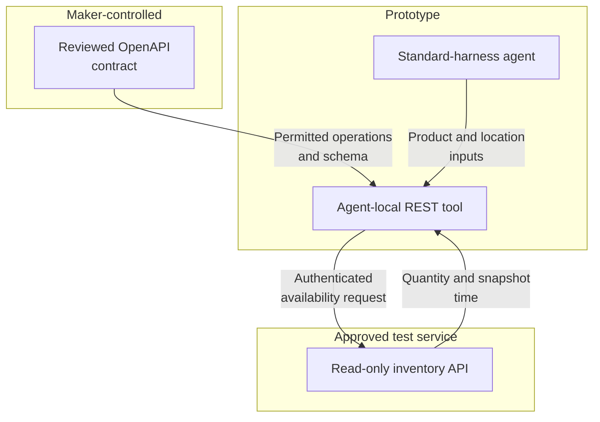
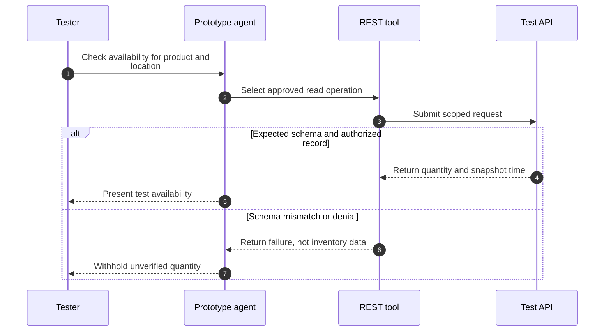

# Prototype an agent-local REST tool from OpenAPI

**Class:** Synthesized technical pattern. **Status:** The documented direct REST API tool is **preview** on the standard harness. **Intent:** Try a narrow API operation before investing in a shared connector.

## Architecture

**Review decision:** Treat the direct REST tool as a standard-harness preview prototype. Decide whether reuse, release controls and support requirements justify a connector before moving to production.

## Technical flow

## Design notes

**Flow:** Give the agent a reviewed OpenAPI description for an approved service, configure the authentication scheme and select only the needed operations. For an availability prototype, accept a product ID and location, then present the returned quantity and snapshot time. Define what an empty result means.

**Choose it when** one agent needs a small, well-defined integration in a nonproduction evaluation. API configuration is local to the agent; promote widely reused operations to a governed connector or centrally managed tool service instead. Verify OpenAPI compatibility after import.

**Trust boundary:** Endpoint, method and credential policy belong in the configuration, not the prompt. Limit the prototype to read-only synthetic or approved test data. API scopes still need enforcement by the receiving service.

**Failure handling:** Validate required fields and response type; do not turn an error body into an availability answer. Test an incompatible schema revision and an unauthorized product before treating the prototype as evidence for a production design.

**Source:** [Extend your agent with tools from a REST API (preview)](https://learn.microsoft.com/en-us/microsoft-copilot-studio/agent-extend-action-rest-api).
