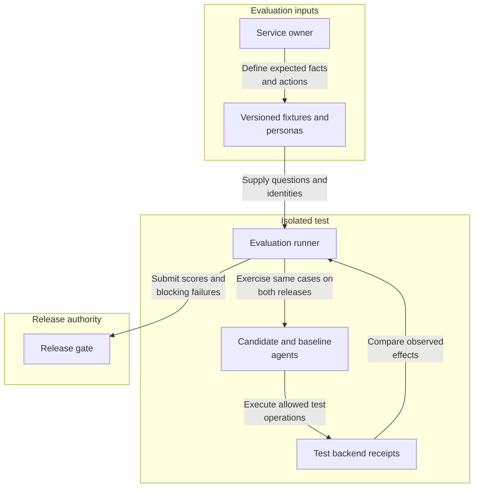
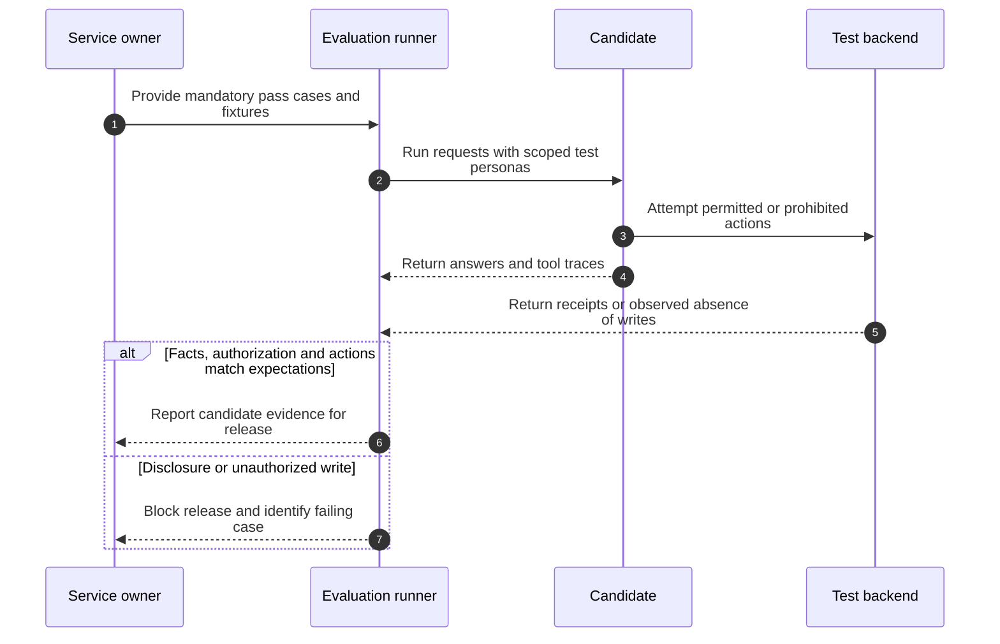

# Gate changes on expected answers and observable actions

**Class:** Synthesized technical pattern. **Intent:** Catch a regression in what the agent *does*, even when the response still sounds plausible.

## Architecture

**Review decision:** Decide which failures block release regardless of the average score. Check actions against backend receipts, not an agent's claim that an operation succeeded.

## Technical flow

## Copilot Studio components

**Recommended build ([harness](../COMPONENTS.md#the-harness-is-the-first-decision)):** Any harness. On usage-based harnesses, generating and running evaluations consumes credits. Budget them as release cost.

| Component | Use in this pattern | Harness alternative |
| --- | --- | --- |
| [Evaluation](../COMPONENTS.md#evaluation): Versioned test sets | Cover successful, ambiguous, denied and unavailable cases. | All harnesses. |
| [Solutions and ALM](../COMPONENTS.md#solutions-and-alm): Candidate and baseline releases | Compare the same pack across versions. | All harnesses. |
| [Monitor and analytics](../COMPONENTS.md#monitor-and-analytics): Activity trace and test receipts | Check actions against backend receipts. | Copilot: reasoning trace. |
| [Environments and data policies](../COMPONENTS.md#environments-and-data-policies): Isolated test environment | Keeps test data and capacity separate. | All harnesses. |

**Not the right component:** Using a model's judgment as the only verdict on actions.

**Copilot Credits drivers (medium):** On the Copilot harness, evaluations are billed. On the standard harness, agent flow test runs from test chat don't consume agent flow capacity, but published test traffic does. Size packs to risk. See [Copilot Credits guidance](../COPILOT-CREDITS.md).

## Design notes

**Flow:** The service owner defines an output contract and a versioned pack of questions, identities, test data and expected outcomes. Include successful, ambiguous, denied and unavailable cases. Run the pack against a candidate and the previous release. Check facts against source records, citations against permitted documents, and actions against test-system receipts. Human reviewers judge ambiguity and usefulness rather than delegating every verdict to another model.

**Choose it when** changing instructions, tools, grounding, harness or model could alter behavior. An exact numeric check suits a governed measure; a rubric suits a summary. Repeated trials expose inconsistent routing that a single pass can miss.

**Trust boundary:** Use nonproduction fixtures and scoped identities; prevent evaluation requests from sending real notifications or posting transactions. Keep raw production conversations out of the test set unless their use is explicitly authorized.

**Failure handling:** Block a release that discloses a restricted result or performs an unapproved write even if its average score improves. Record the failing case, version and owner. Re-run it in the target channel before lifting the gate.

**Sources:** [Microsoft agent evaluation framework](https://learn.microsoft.com/en-us/agents/agent-evaluation/) · [Analytical output contracts and golden prompts](https://learn.microsoft.com/en-us/power-platform/architecture/key-concepts/copilot-studio-fabric/evaluate-analytical-agents) · [Microsoft public evaluation gate sample](https://github.com/microsoft/CopilotStudioSamples/tree/main/testing/evaluation/EvalGateADO).
