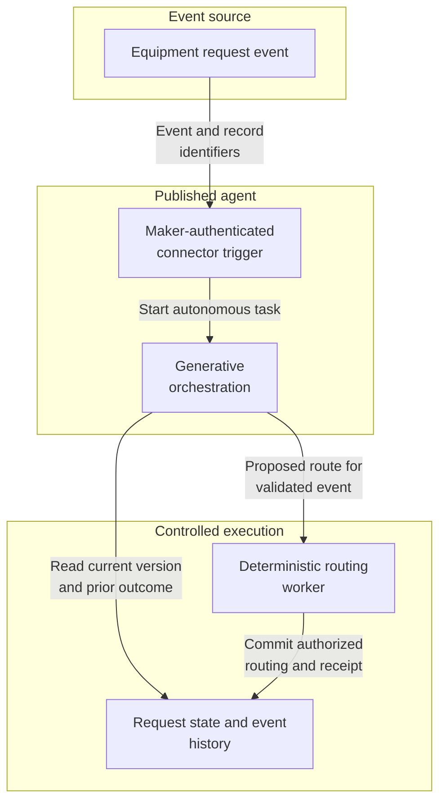
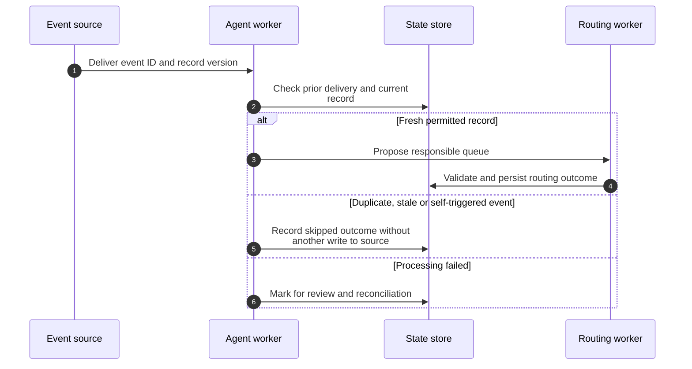

# Start a bounded agent task from a business event

**Class:** Synthesized technical pattern. **Intent:** Act on a new business record without waiting for someone to open a chat.

## Architecture

**Review decision:** Approve the trigger identity and retry policy before enabling autonomous work. Event contents supply data; they do not represent a signed-in user's delegated authority.

## Technical flow

## Copilot Studio components

**Recommended build ([harness](../COMPONENTS.md#the-harness-is-the-first-decision)):** Standard harness with an event trigger and generative orchestration. On the Microsoft Copilot harness, use an agent trigger (preview) or a workflow trigger and agent node. A post-tool-use hook can write audit records.

| Component | Use in this pattern | Harness alternative |
| --- | --- | --- |
| [Trigger](../COMPONENTS.md#triggers-and-autonomous-agents): Connector event trigger | Sends the new request's payload. Documented triggers use maker credentials. | Copilot: agent trigger (preview) or workflow trigger. |
| [Orchestration](../COMPONENTS.md#orchestration-modes): Generative orchestration | Retrieves current state, classifies the request and proposes a queue. | Copilot: reasoning loop. |
| [Connector tool](../COMPONENTS.md#connector-tools): Read current record | Uses the record key rather than trusting the payload. | All harnesses. |
| [Agent flow](../COMPONENTS.md#agent-flows): Deterministic routing worker | Commits the routing change idempotently. | Copilot: workflow. |
| [Hook](../COMPONENTS.md#hooks-preview): Post tool use | Writes audit records consistently. *(Optional.)* | Copilot only. |

**Not the right component:** Treating instructions in the event body as commands.

**Copilot Credits drivers (high):** Every event bills a trigger (agent action) plus orchestration, even for licensed users, and agent flows called by an autonomous agent are billed. Filter upstream, deduplicate and set agent limits. See [Copilot Credits guidance](../COPILOT-CREDITS.md).

## Design notes

**Flow:** A configured connector event sends a payload to a published agent with generative orchestration. For example, on creation of a new equipment request, use the record key to retrieve current state, classify the request and propose the responsible queue. Persist event ID, processing status and outcome; a deterministic worker should handle any committed routing change.

**Choose it when** the event is known but the appropriate next step depends on the record. Use a simple flow without an agent if a field-to-queue mapping suffices. Filter events upstream and budget for burst traffic and credit consumption.

**Trust boundary:** The documented event triggers use maker credentials, not the event sender's delegated identity. Scope the configured connections; verify the originating record and permitted actions. A message body in the event is untrusted data, not instructions from an administrator.

**Failure handling:** Deduplicate on event and record version. Avoid retriggering on the agent's own status update. Isolate failed records for review, and reconcile state before replay. Test duplicate, out-of-order and unauthorized events, including when no interactive user is present.

**Source:** [Event trigger overview, billing and publishing behavior](https://learn.microsoft.com/en-us/microsoft-copilot-studio/authoring-triggers-about).
