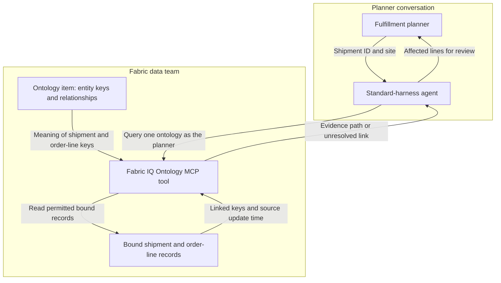
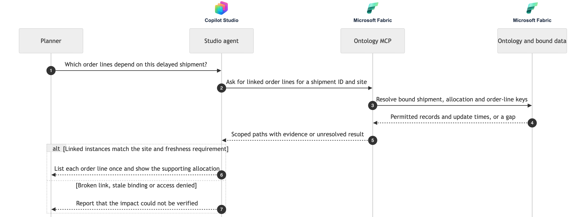
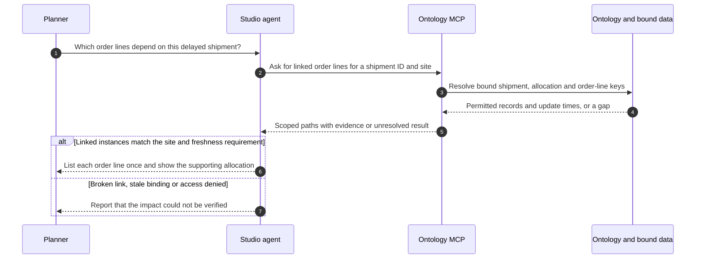

# Trace an affected order through a Fabric IQ ontology

**Class:** Synthesized technical pattern. **Intent:** When a shipment is delayed, tell a fulfillment planner which order lines are linked to it and why. Return the evidence path, not a count of late orders or an instruction to reroute stock.

## Architecture

**Review decision:** What proves that *this shipment* carries *this order line*? Require a bound relationship with stable keys. Matching a product name, or merely finding both entity types in the schema, is insufficient.

## Technical flow

Text and editable Mermaid sequence

## Copilot Studio components

**Recommended build ([harness](../COMPONENTS.md#the-harness-is-the-first-decision)):** Standard harness with the **Fabric IQ Ontology MCP** tool (preview). Bind the connection to the approved Fabric workspace and ontology item. This is a direct tool call, not a second agent. Use this design for a preview evaluation, not a production dependency on an unsupported preview feature.

| Component | Use in this pattern | Alternative |
| --- | --- | --- |
| [MCP tool](../COMPONENTS.md#mcp-servers) | In **Tools → Add a tool → Model Context Protocol**, select **Fabric IQ Ontology**. `list_ontology_entity_types` describes the schema; `search_ontology` queries the data. A type definition is not evidence that two records are linked. | A [connected Fabric data agent](../decision-patterns/fabric-connected.md) is a separate preview alternative if a Fabric team already owns the query agent. |
| [Authentication](../COMPONENTS.md#authentication-and-tool-credentials) | Require a signed-in planner authorized for the approved item and underlying records. Test actual access under two different accounts. | On the Microsoft Copilot harness, the [Fabric IQ tool](https://learn.microsoft.com/en-us/microsoft-copilot-studio/agents-experience/fabric-iq-connect) documents semantic-model access; it is not the standard harness ontology picker. |
| [Instructions](../COMPONENTS.md#instructions) and [evaluation](../COMPONENTS.md#evaluation) | Require instance keys, relationship and as-of time for every impact claim. | For totals by period, use the [semantic model contract](semantic-model-contract.md) and [Fabric analytics choices](../decision-patterns/fabric-connected.md). |

**Copilot Credits drivers (medium):** Count Studio MCP tool calls and answers, including any schema lookups or retries for ambiguous IDs. Budget Fabric capacity and any graph materialization separately. See [Copilot Credits guidance](../COPILOT-CREDITS.md).

## Design notes

**Choose it when** the path determines the answer. Model `Shipment → Allocation → OrderLine` with site-qualified keys, quantities and source update times; a split line can have multiple allocations. The ontology defines meaning and bindings, not a general-purpose query engine. Only report an affected allocation, not that the whole order is late. A schema graph does not contain instances by default; materialize selected entities and relationships only if the traversal needs graph execution.

**Availability:** Check preview tenant settings, paid F2+ or Fabric-enabled P1+ capacity, the enabled MCP tool in the Studio environment, and licensing for Agent 365 governance. The **GA Fabric IQ MCP server** for Power BI reports and semantic models does **not** query ontologies or data agents. It is not the item-specific Ontology MCP server and is not a fallback for a missing relationship.

**Trust boundary and acceptance tests:** The planner's read permissions govern both hops. No fulfillment write tool is exposed; a dispatcher must independently check inventory and authorize any reroute. Test a split shipment against known allocation IDs, including two sites that reuse a local ID. Remove one binding or revoke access to one source: withhold the unsupported path without naming hidden orders. A stale allocation must be labeled unverified, never converted into a stock move.

**Sources:** [Studio: connect the Fabric IQ Ontology MCP tool (preview)](https://learn.microsoft.com/en-us/microsoft-copilot-studio/mcp-fabric-iq-ontology) · [Ontology in Fabric IQ](https://learn.microsoft.com/en-us/fabric/iq/ontology/overview) · [Ontology MCP permissions and limitations](https://learn.microsoft.com/en-us/fabric/iq/ontology/how-to-use-ontology-mcp-server) · [Fabric IQ MCP scope and exclusions](https://learn.microsoft.com/en-us/fabric/iq/connectors/fabric-iq-mcp).
