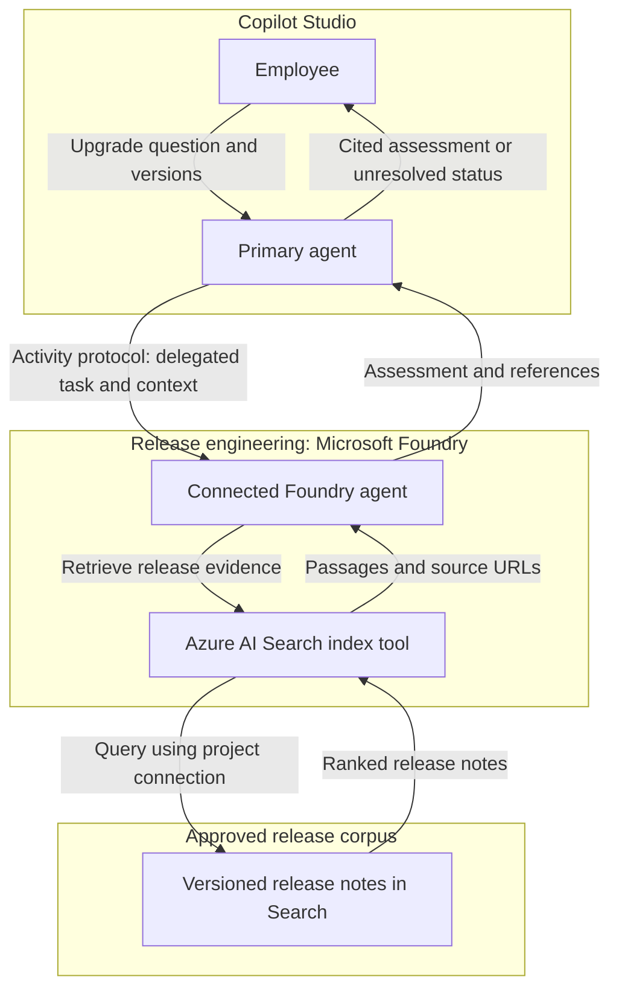
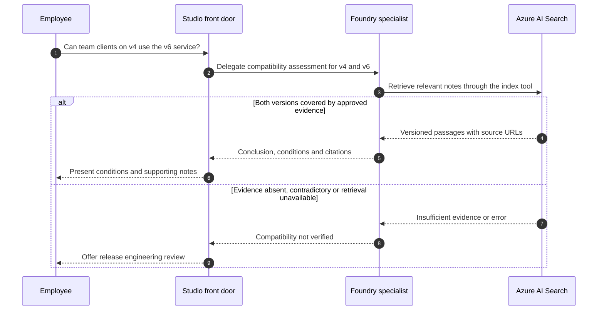

# Delegate release compatibility questions to a Foundry agent

**Class:** Synthesized technical pattern. **Intent:** Give employees one Studio front door while the release engineering team owns the Foundry agent that compares release notes, applies compatibility rules and cites its evidence.

## Architecture

**Review decision:** Delegate when the release team owns **how to reach a conclusion**, including its model, instructions and tests. If the task is just “return the release note for version X,” give the parent a lookup tool instead: one query, one authorization check and no second agent interpreting the question.

## Technical flow

## Copilot Studio components

**Recommended build ([harness](../COMPONENTS.md#the-harness-is-the-first-decision)):** Microsoft Copilot harness. Use **Build → Connected agents → Add → Add Foundry agent**. This is the documented external-agent integration, not the [same-environment Studio specialist](connected-agent.md). The specialist's Search tool belongs to Foundry; do not attach the index to the parent as well.

| Component | Use in this pattern | Alternative |
| --- | --- | --- |
| [Connected agent](../COMPONENTS.md#connected-agents): Microsoft Foundry | Select a connection using Microsoft Entra ID user login and the **Foundry project endpoint**. Supply the **Agent ID**, name and a description specific to cross-version assessments. | Standard documents a separate **preview** path: **Agents → Add an agent → Connect to an external agent → Microsoft Foundry**. |
| [Instructions](../COMPONENTS.md#instructions): routing and response | Parent retains ordinary lookups; specialist assesses compatibility. Require both versions and citations, or an explicit unresolved result. | Use a [Foundry IQ retrieval tool](foundry-iq-knowledge-base.md) if the parent should interpret the evidence itself. |
| [Authentication](../COMPONENTS.md#authentication-and-tool-credentials): front door and project access | Restrict entry to the approved audience; authorize the connection to the Foundry project separately. | For user-specific documents, choose retrieval that enforces the reader's grants rather than broadening the project connection. |

**Copilot Credits drivers (high):** On the Microsoft Copilot harness, routing, delegation and interpreting the result add runtime turns and tokens; returned context, retries, preview and evaluation affect usage. The Foundry specialist's model and its Search index, embeddings and optional semantic ranking are separate Azure costs, **not** a second Studio agent's credit charge. The Standard preview parent uses Standard billing instead. See [Copilot Credits guidance](../COPILOT-CREDITS.md).

## Design notes

- **Connection prerequisites:** Use an existing agent created in the current Foundry portal, permission to access its project, and the **Activity** protocol with the required authorization scheme (`BotServiceRbac`). Responses or A2A support alone is insufficient. A connection can save but fail on first use with HTTP 400 if Activity is missing; a previous-portal agent can return `404 - Version not found`. Check the integration and preview terms for the chosen harness.
- **Retrieval contract:** The Foundry index tool uses a project connection and named index. Provide searchable text and vectors plus retrievable passage text and source URLs. Pin the corpus to approved release notes; retrieve both versions and return only the conclusion, applicable conditions and links. If a necessary note is missing, “not verified” is different from “incompatible.”
- **Trust:** The parent can forward relevant history and rephrase the request. A routing description is not a redaction rule: use this design only if that context may cross into the Foundry project. The project connection's identity and any static index filter apply to the specialist's calls; neither proves access for the employee. Keep this index readable by the entire approved audience, or enforce verified per-document authorization before the model sees evidence. Use retrieval as a tool, not a second connected-agent hop.
- **Failure and evaluation:** Test a two-version comparison (delegates), a one-version lookup (stays local), and conflicting notes (abstains). Check citations and conditions in the **final channel response**, not just the specialist's output. Simulate project denial, an unavailable specialist and a Search timeout: the parent should stop without trying a broader source. Re-run these cases when the specialist, index or routing description changes; compare end-to-end latency and cost with a direct lookup.

**Sources:** [Studio: add a Foundry connected agent](https://learn.microsoft.com/en-us/microsoft-copilot-studio/agents-experience/add-agent-foundry) · [Standard harness integration (preview)](https://learn.microsoft.com/en-us/microsoft-copilot-studio/add-agent-foundry-agent) · [Delegated context and one-level limit](https://learn.microsoft.com/en-us/microsoft-copilot-studio/agents-experience/authoring-add-other-agents) · [Foundry: connect a Search index tool](https://learn.microsoft.com/en-us/azure/foundry/agents/how-to/tools/ai-search).
