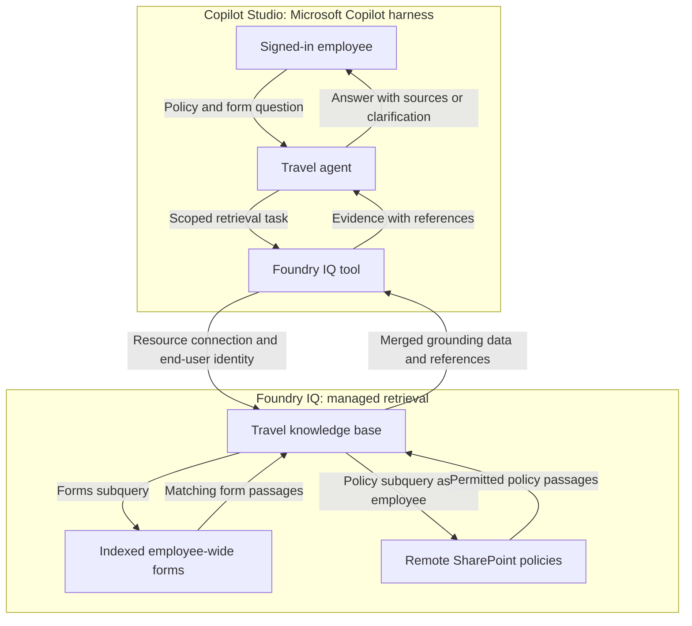
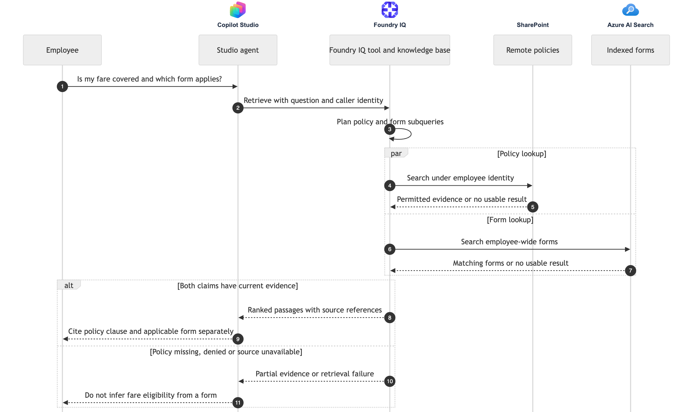
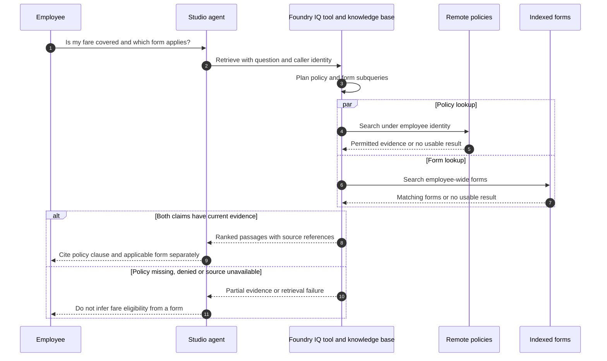

# Answer cross-source questions with a Foundry IQ knowledge base

**Class:** Synthesized technical pattern. **Intent:** Let a Studio agent answer “Does the travel policy cover this fare, and which form do I need?” when the policy and the forms have different owners. Keep source selection, retrieval settings and permissions with the team that owns the knowledge base.

## Architecture

**Review decision:** Does answering the question require evidence from several sources, and can each source enforce the intended audience? Share a knowledge base when the answers are yes. For one index and a single lookup, [classic hybrid retrieval](azure-search-hybrid-rag.md) is easier to tune and evaluate.

## Technical flow

Text and editable Mermaid sequence

## Copilot Studio components

**Recommended build ([harness](../COMPONENTS.md#the-harness-is-the-first-decision)):** Microsoft Copilot harness. In **Build → Tools → Foundry IQ**, choose or create a connection to the Search service, select an existing knowledge base and save. The maker needs access to the base; the documented picker supports **one Foundry IQ connection per agent**, not one per source.

| Component | Use in this pattern | Harness alternative |
| --- | --- | --- |
| Foundry IQ tool | Name the domain in the tool description. The base, its sources and retrieval settings live in Foundry IQ, not in Studio. | Customer Conversation documents **Build → primary agent or sub-agent card → Microsoft IQ → Foundry IQ**. Standard's **Add knowledge → Azure AI Search** selects an index, not a base. |
| [Instructions](../COMPONENTS.md#instructions) and [authentication](../COMPONENTS.md#authentication-and-tool-credentials) | Ask for jurisdiction when ambiguous; require a reference for each claim. Use a channel with verified employee sign-in. | A Standard topic with an authorized broker is a custom design, not the Foundry IQ picker. |

**Copilot Credits drivers (medium):** Studio meters the tool call, harness work and model tokens for the returned context; preview and evaluations also consume credits. Separately budget Search capacity and Foundry IQ retrieval tokens, embedding work for indexed sources, and model tokens for planning or optional answer synthesis. A remote source can have its own meter. See [Copilot Credits guidance](../COPILOT-CREDITS.md).

## Design notes

- **Managed retrieval:** The base needs at least one source in a supported Search region. This design uses model-backed planning to split the question, search selected sources in parallel, rerank and merge evidence. Return extractive passages and references so Studio composes the answer once. Ordinary minimal-effort extraction skips model-based planning; not every request needs a planner.
- **Availability:** The Search `2026-10-01` GA REST contract supports planning, synthesis and citations; this doesn't make every source or client feature GA. The **remote SharePoint source is preview** and requires a common Entra tenant and either qualifying Microsoft 365 Copilot licensing or enabled Retrieval API pay-as-you-go. Check region, source support and licensing before selecting it.
- **Trust:** The maker's connection authenticates Studio to the resource; Studio also passes the end user's identity. Sources that support end-user tokens, such as remote SharePoint, can trim to that user. An indexed source needs supported, current document permissions or an audience entitled to its entire contents, as with the forms here. Neither a service principal nor a citation link grants document-level protection. Exclude sources that cannot meet that test.
- **Failure and evaluation:** Compare the same two-part question for a reader and a non-reader of the policy. Score the policy citation and form citation independently; a relevant form is not evidence that the fare is covered. Remove the policy permission and simulate a source timeout: do not disclose the title or fill the gap from general knowledge. In Studio **Preview**, inspect the activity trace for the Foundry IQ call and returned items. Compare coverage, latency and cost with a single-query baseline before increasing reasoning effort.

**Sources:** [Studio: connect the Foundry IQ tool](https://learn.microsoft.com/en-us/microsoft-copilot-studio/agents-experience/foundry-iq-connect) · [Customer Conversation connection surface](https://learn.microsoft.com/en-us/microsoft-copilot-studio/agents-experience/foundry-iq-connect-customer-conversation) · [Foundry IQ components and end-user authorization](https://learn.microsoft.com/en-us/azure/foundry/agents/concepts/what-is-foundry-iq) · [Search: agentic retrieval, availability and billing](https://learn.microsoft.com/en-us/azure/search/agentic-retrieval-overview) · [Remote SharePoint prerequisites](https://learn.microsoft.com/en-us/azure/search/agentic-knowledge-source-how-to-sharepoint-remote).
