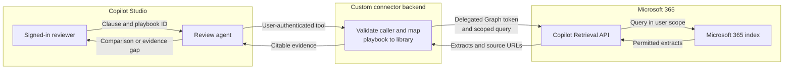
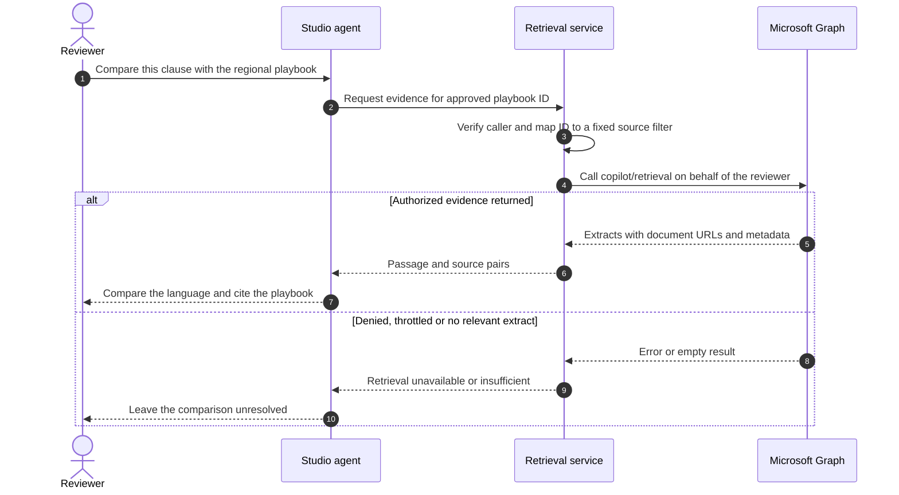

# Retrieve cited Microsoft 365 text without copying the library

**Class:** Synthesized technical pattern. **Intent:** Let a contract reviewer compare a supplier clause with their authorized playbook. Use the Microsoft 365 Copilot Retrieval API to obtain passages; do not export the playbook to another vector index or let the agent approve the clause.

## Architecture

**Review decision:** Is native [SharePoint grounding](sharepoint-grounding.md) enough? Use a custom retrieval path when several applications need the same library selection, evidence format and citation checks. The extra service brings a consent and operations burden.

## Technical flow

## Copilot Studio components

**Recommended build:** Standard harness with a [user-authenticated custom connector](../COMPONENTS.md#connector-tools) for a single `getPlaybookEvidence` operation. The API returns **text**, not a finished answer. Use the orchestrator to explain the difference and link each conclusion to a passage. The same service can be consumed by another supported client; a second agent, persistent memory and a second index are not prerequisites.

| Component | Use in this pattern | Harness alternative |
| --- | --- | --- |
| [Connector tool](../COMPONENTS.md#connector-tools) | Expose the playbook ID and question, not arbitrary Graph filters. | On the Microsoft Copilot harness, use a connector with the same delegated contract; no standard topic is required. |
| [Instructions](../COMPONENTS.md#instructions) | Require a citation for each playbook claim and flag conflicting revisions. | Keep these rules with the answering agent regardless of harness. |

**Copilot Credits drivers (medium):** Estimate the Studio tool call and answer separately from Retrieval API entitlement. Microsoft documents inclusion of the API for Microsoft 365 Copilot add-on users, and preview pay-as-you-go for eligible tenant sources such as SharePoint, **not OneDrive**, for other users. That inclusion is not a blanket license for the calling harness or a separate Foundry model. See [Copilot Credits guidance](../COPILOT-CREDITS.md).

## Design notes

- **API contract:** The service calls Graph v1.0 `POST /copilot/retrieval` with `dataSource: sharePoint`. Map the playbook ID to a server-owned `filterExpression`. A malformed filter can run as if no filter were supplied: validate configured filters and reject returned URLs outside the approved library **before** sending passages to Studio. Keep each extract attached to its source URL. Results are unordered: the first passage is not necessarily current.
- **Trust boundary:** This API uses delegated work or school identity, not application permissions. SharePoint retrieval requires both `Files.Read.All` and `Sites.Read.All` delegated permissions. Assess tenant consent before choosing this design. If using a middle tier, exchange a token addressed to that service for a Graph token using on-behalf-of; do not forward a token meant for another audience. The library filter limits relevance; Microsoft 365 permissions determine access. Keep extracts out of shared caches and logs.
- **Failure handling and acceptance:** Try an obsolete and a current playbook with conflicting clauses, remove a reviewer's library access, then repeat the same question. The agent should cite the applicable version or report a conflict, never reveal an inaccessible title, and never describe an empty result as approval. Verify API availability in the target cloud.

**Sources:** [Microsoft 365 Copilot Retrieval API: capabilities, licensing and limits](https://learn.microsoft.com/en-us/microsoft-365/copilot/extensibility/api/ai-services/retrieval/overview) · [Graph operation and permissions](https://learn.microsoft.com/en-us/microsoft-365/copilot/extensibility/api/ai-services/retrieval/copilotroot-retrieval) · [Microsoft identity platform on-behalf-of flow](https://learn.microsoft.com/en-us/entra/identity-platform/v2-oauth2-on-behalf-of-flow).
