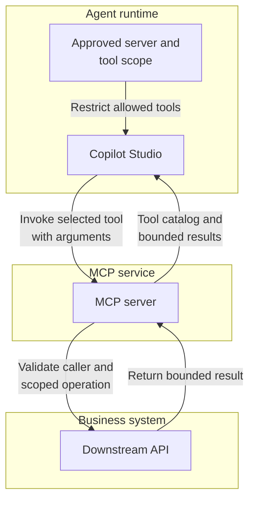
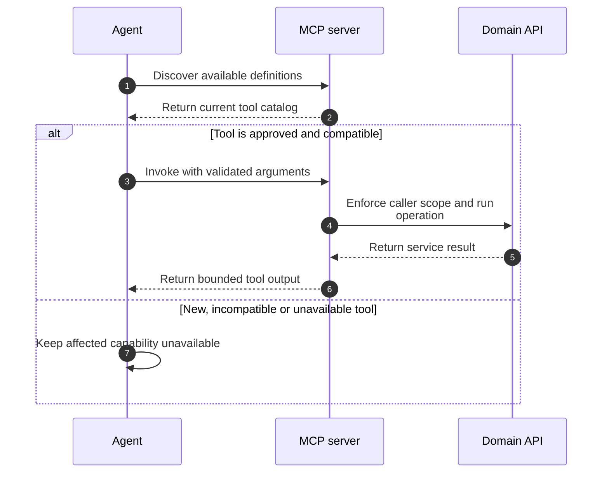

# Discover centrally managed tools from an MCP server

**Class:** Synthesized technical pattern. **Intent:** Let several agents consume a tool catalog maintained by the API owner rather than maintaining a separate description in every agent.

## Architecture

**Review decision:** The server can change its catalog without an agent release. Approve what the agent may invoke independently of what the server advertises.

## Technical flow

## Copilot Studio components

**Recommended build ([harness](../COMPONENTS.md#the-harness-is-the-first-decision)):** Any harness. On the Microsoft Copilot harness, a pre-tool-use hook can block calls outside the approved scope.

| Component | Use in this pattern | Harness alternative |
| --- | --- | --- |
| [MCP server](../COMPONENTS.md#mcp-servers): Approved MCP server | Advertises tools that the agent discovers. | All harnesses. |
| [Environments and data policies](../COMPONENTS.md#environments-and-data-policies): Enabled-tool scope and DLP | Approves which tools the agent may invoke. | All harnesses. |
| [Authentication](../COMPONENTS.md#authentication-and-tool-credentials): Connection identity | The server validates the caller and arguments. | All harnesses. |
| [Hook](../COMPONENTS.md#hooks-preview): Pre tool use | Blocks a call that breaks policy. *(Optional.)* | Copilot only. |

**Not the right component:** Assuming everything the server advertises is approved.

**Copilot Credits drivers (low):** MCP tool calls are agent actions on the standard harness and usage-based on the others. Large tool catalogs and results enlarge context, so enable only needed tools. See [Copilot Credits guidance](../COPILOT-CREDITS.md).

## Design notes

**Flow:** An approved Model Context Protocol (MCP) server advertises tool definitions. Copilot Studio connects using a supported configuration and discovers tools; the agent invokes the relevant one with structured arguments. The server validates the operation, caller and arguments, calls the underlying system, and returns a bounded result.

**Choose it when** tools evolve together or are consumed by multiple agents or clients. A single supported connector usually costs less to operate. Check which tools, resources, authentication modes and transport the selected harness actually supports.

On the producer side, an API team can [publish selected REST operations through APIM](apim-rest-to-mcp.md) instead of building a separate MCP server. For an external provider, review the [partner data boundary](partner-iq-provider.md) as well as the MCP contract.

**Trust boundary:** Discovery is not approval. Restrict servers and downstream permissions; review changes in exposed tools and descriptions before broad use. Do not let a read-only agent acquire a write capability just because the server added it.

**Failure handling:** Set timeouts and validate tool output. On incompatible schema or an unavailable server, disable the affected capability rather than falling back to unbounded HTTP. Test a catalog update and verify denied tools stay inaccessible.

**Sources:** [Extend agents with Model Context Protocol](https://learn.microsoft.com/en-us/microsoft-copilot-studio/guidance/extend-with-model-context-protocol) · [Microsoft public Copilot Studio MCP samples](https://github.com/microsoft/CopilotStudioSamples/tree/main/extensibility/mcp).
