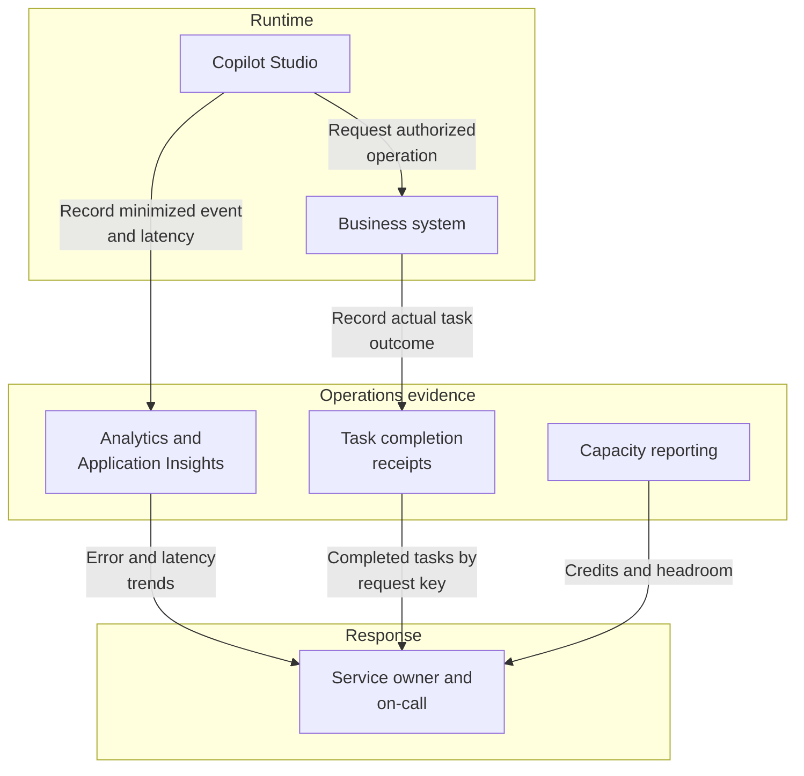
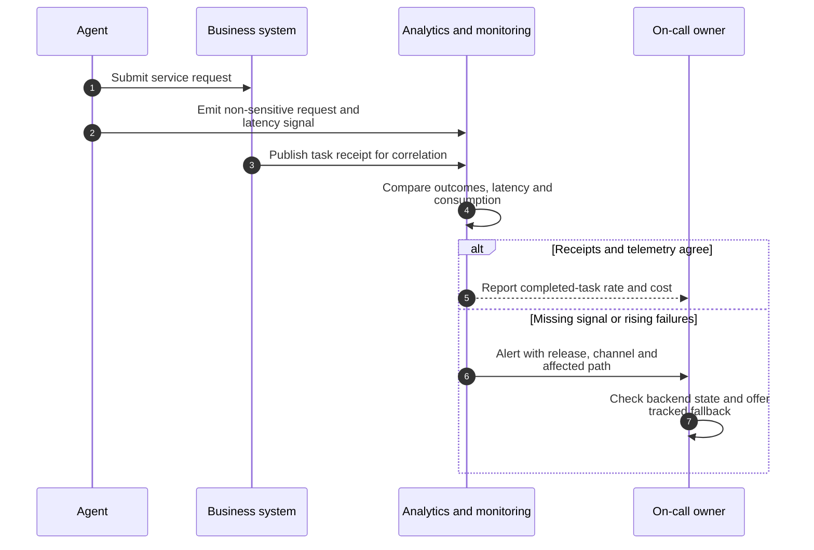

# Monitor completed tasks, tool health and consumption together

**Class:** Synthesized technical pattern. **Intent:** Distinguish an agent that is answering messages from one that is actually completing its service.

## Architecture

**Review decision:** Assign an owner to the business outcome, not just the chat endpoint. Compare backend receipts with telemetry so a silent integration is not mistaken for healthy service.

## Technical flow

## Design notes

**Flow:** Define a business outcome such as “case created and reference returned.” Use Copilot Studio analytics for conversation trends, downstream receipts for task completion, and the admin center for capacity. On the standard harness, Application Insights can capture agent events. Correlate outcome, latency and error category with release and channel using a non-sensitive request identifier.

**Choose it when** someone is accountable for service levels or spend. Track tail latency, failed and abandoned tasks, handoff acceptance and credits per completed task. Raw message counts cannot distinguish successful self-service from repeated retries. Use the [transcript analysis architecture](../reference-architectures/conversation-transcripts.md) only if aggregate signals do not explain a trend.

**Trust boundary:** Conversation details, sensitive activity properties and tool arguments may contain personal data. Leave detailed logging off unless justified; specify access, retention and deletion for all telemetry copies. Operational metrics are not a substitute for an audited business receipt.

**Failure handling:** Alert on missing telemetry as well as rising errors. Compare a drop in activity to backend receipts before declaring the service healthy. Give the on-call owner a response for connector outages or credit exhaustion: pause the affected path and direct users to a tracked alternative.

**Sources:** [Monitor operations, compliance and capacity](https://learn.microsoft.com/en-us/microsoft-copilot-studio/guidance/sec-gov-phase5) · [Standard-harness telemetry and optional logging fields](https://learn.microsoft.com/en-us/microsoft-copilot-studio/advanced-bot-framework-composer-capture-telemetry).
