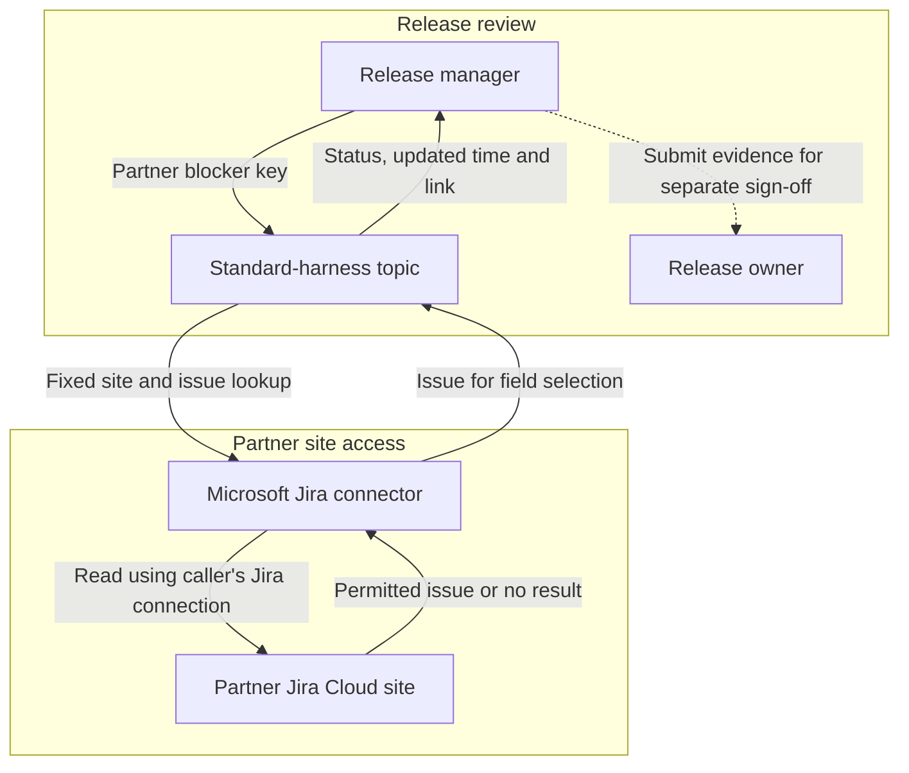
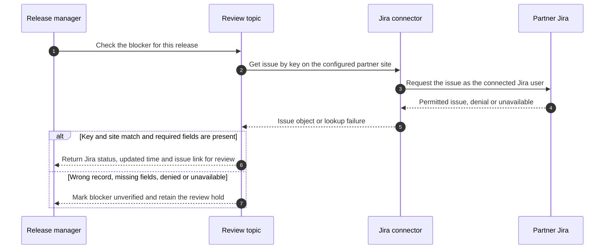

# Use partner-held Jira evidence in a release review

**Class:** Synthesized technical pattern. **Intent:** Let a release manager check a blocker held in a delivery partner's Jira Cloud site without copying the partner's project into a shared index. Show the current status and when the issue was last updated; leave release sign-off to the release owner.

## Architecture

**Review decision:** Is the provider authorized to disclose these fields to this caller for this purpose? A partner login, or a connector appearing in a gallery, is neither approval to redistribute the issue nor authority to ship.

## Technical flow

## Copilot Studio components

**Recommended build ([harness](../COMPONENTS.md#the-harness-is-the-first-decision)):** Standard harness, a topic and the Microsoft-published **Jira** premium connector. “Partner IQ” or “third-party IQ” here describes a source of context, not a fifth [Microsoft IQ capability](https://learn.microsoft.com/en-us/microsoft-iq/) or a standard provider API. Jira Cloud remains the system of record.

| Component | Use in this pattern | Alternative |
| --- | --- | --- |
| [Topic](../COMPONENTS.md#topics-and-system-topics) + [connector tool](../COMPONENTS.md#connector-tools) | Call **Get issue by key (V2)**. Pin the partner site and constrain project keys. Select status, updated time and key for the reply; exclude comments, attachments and descriptions. | Microsoft Copilot harness: use the same single connector operation for a longer review, subject to channel and credential support. |
| [Tool credentials](../COMPONENTS.md#authentication-and-tool-credentials) | Use the caller's own Jira connection. With OAuth, bind the verified Jira Cloud ID, not a URL generated by the model. | A provider-owned MCP option is Atlassian's `getJiraIssue` in `read_jira`; validate client, auth and tool restrictions separately before substituting it. |
| [Human gate](../COMPONENTS.md#human-in-the-loop-gates) | The release owner signs off in the release system under its own policy. | When that system is unavailable, return the evidence only; never transition the ticket as a proxy for approval. |

**Copilot Credits drivers (low):** One bounded lookup and short topic response; standard-harness action and answer meters apply where billable. Provider subscriptions, connector licensing and API quotas are separate from Copilot Credits. See [Copilot Credits guidance](../COPILOT-CREDITS.md).

## Design notes

**Choose it when** an external party owns fast-changing facts and the reviewer already has permission to see them. Unlike the generic [connector action](connector-action.md), the key design choice is whose record and clock to trust: identify the partner site, issue key, source update time and lookup time. The issue's update time is not the time of its last status transition. “Resolved” is the partner's workflow status, not proof that your acceptance criteria passed.

**Availability:** Microsoft's connector reference lists Studio support except in China Cloud operated by 21Vianet. [Microsoft 365 federated connectors](https://learn.microsoft.com/en-us/microsoft-365/copilot/connectors/federated-connectors-overview) also list **Atlassian Rovo** for live MCP access in specified Microsoft 365 Copilot experiences. Gallery availability is not registration of that connector in an arbitrary Studio harness. If neither approved integration is available, route the reviewer to the partner site, not a cached issue dump.

**Trust boundary:** Enforce Jira project and issue-level permissions at the source. Fix the site even when the caller belongs to multiple sites with the same issue keys. Expose no transition or comment operation. Review provider terms, connector data policy and transcript access before returning partner fields. If the full connector object must not enter Studio, enforce field projection in a read-only adapter **before** the Studio boundary, or do not connect.

**Acceptance tests:** Seed the same key on two sites; only the configured site's status and link may appear. A user who loses access must receive no title, status or hint distinguishing a private issue from a missing one. Simulate a rate limit and a missing update timestamp: keep the hold, don't consult an older shared result. A resolved issue must still leave the release unsigned.

**Sources:** [Jira connector: supported products, authentication and operations](https://learn.microsoft.com/en-us/connectors/jira/) · [Jira Cloud Get issue permissions](https://developer.atlassian.com/cloud/jira/platform/rest/v3/api-group-issues/#api-rest-api-3-issue-issueidorkey-get) · [Atlassian MCP tools and permission groups](https://support.atlassian.com/atlassian-ai-gateway/docs/supported-tools/).
