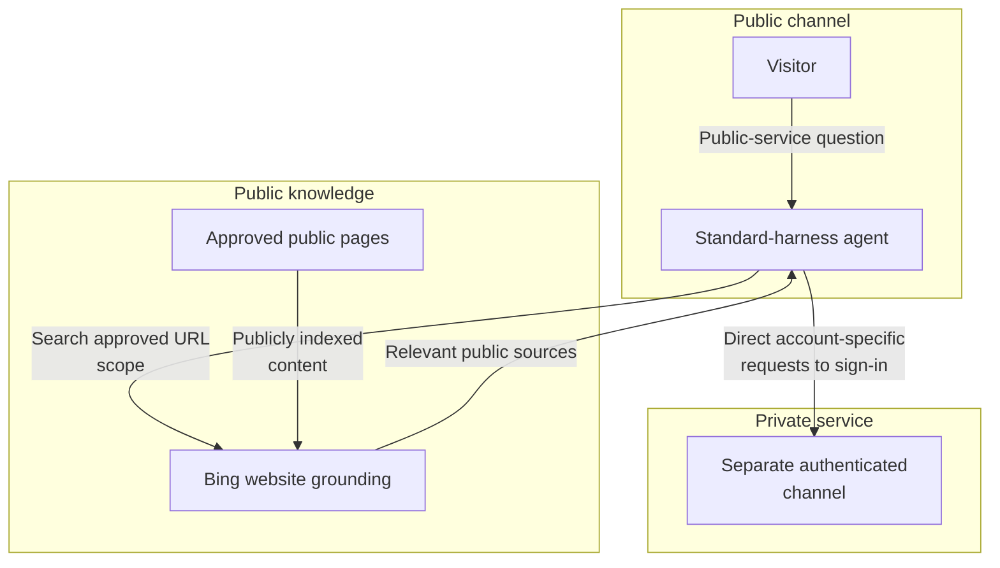
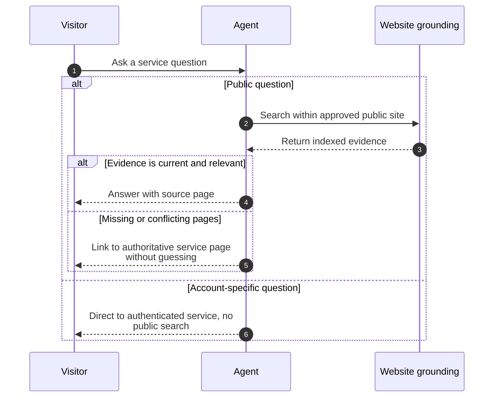

# Public self-service from a bounded website corpus

**Class:** Synthesized technical pattern. **Intent:** Answer public questions about services or products without prompting a visitor to sign in or exposing a private data path.

## Architecture

**Review decision:** Approve the URL scope as public information. A question about a private account must leave this path rather than bringing private data into public search.

## Technical flow

## Copilot Studio components

**Recommended build ([harness](../COMPONENTS.md#the-harness-is-the-first-decision)):** Standard harness, generative orchestration on a public website. The Microsoft Copilot harness also lists public website knowledge, but it adds cost without benefit for short answers.

| Component | Use in this pattern | Harness alternative |
| --- | --- | --- |
| [Knowledge](../COMPONENTS.md#knowledge-sources): Public website sources | Bing grounding within the configured URL scope. | All harnesses. |
| [Channel](../COMPONENTS.md#channels): Website | Anonymous visitors. | Std and Copilot. |
| [Topics](../COMPONENTS.md#topics-and-system-topics): Account-request topic | Sends private requests to a separately authenticated service. | Copilot: instructions. |

**Not the right component:** Bringing private data into the public agent.

**Copilot Credits drivers (medium):** Anonymous visitors aren't covered by Microsoft 365 Copilot licenses. Each grounded answer bills 2 credits. Authored answers for top questions cost 1. See [Copilot Credits guidance](../COPILOT-CREDITS.md).

## Design notes

**Flow:** Configure a standard-harness agent with narrow, approved public website sources. The public website knowledge integration uses Bing grounding within the configured URL scope. Return the source page alongside the answer; send account-specific requests to a separately authenticated service.

**Choose it when** information is intended for everyone and is publicly indexed. A static FAQ is preferable when wording must match a disclosure exactly. Public website retrieval is not a real-time inventory, price or eligibility check.

**Trust boundary:** Treat every response as public. Do not connect internal documents or privileged actions as fallbacks. Review what the selected URL includes, especially user-generated content, and keep personal information out of public search queries.

**Failure handling:** If a page is not indexed, stale or contradicted by a newer notice, link to the authoritative service page rather than resolving the conflict from memory. Test an unindexed page and an account-specific question in the anonymous channel.

**Sources:** [Add a public website as a knowledge source](https://learn.microsoft.com/en-us/microsoft-copilot-studio/knowledge-add-public-website) · [Knowledge source types and authentication](https://learn.microsoft.com/en-us/microsoft-copilot-studio/knowledge-copilot-studio).
