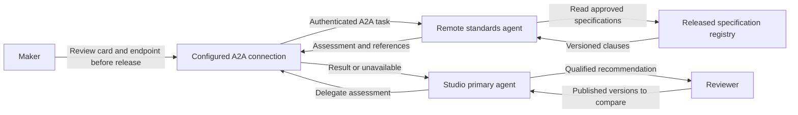
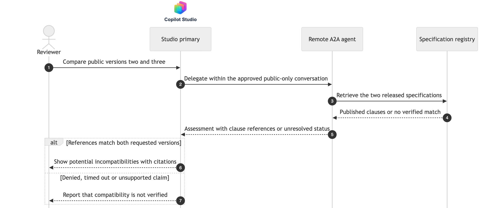
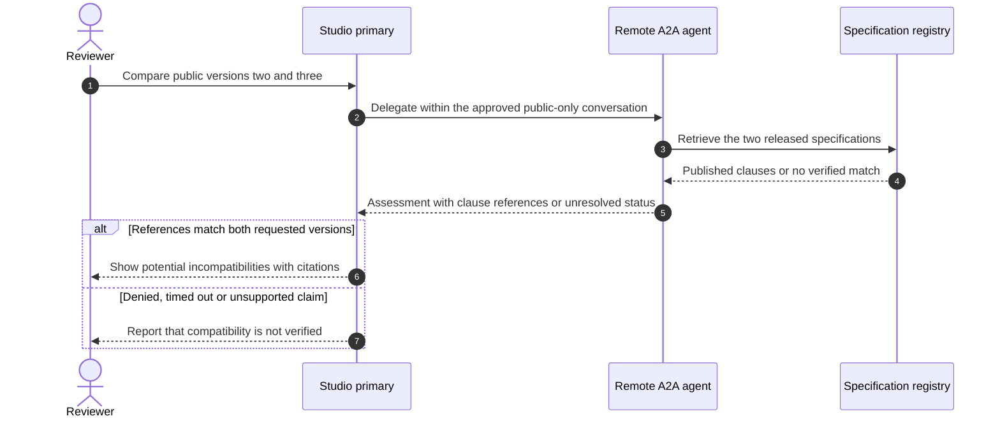

# Delegate a bounded task to a remote Agent2Agent specialist

**Class:** Synthesized technical pattern. **Intent:** A standards team already operates an agent on another framework that compares *published* interface specifications. Let a Studio agent request its assessment without giving the remote agent a user session, unreleased designs or release authority.

## Architecture

**Review decision:** Is independent **reasoning** needed, and is the conversation safe to share with that endpoint? If all you need is a versioned clause, use a read-only API or [MCP tool](mcp-tools.md). Protocol compatibility is not a reason to send private history to another operator.

## Technical flow

Text and editable Mermaid sequence

## Copilot Studio components

**Recommended build:** Microsoft Copilot harness, using **Build → Connected agents → Add A2A agent**. Configure the approved *agent card* URL and restrict routing to released specifications. This is not a Foundry Activity connection.

| Component | Use in this pattern | Harness alternative |
| --- | --- | --- |
| [Connected agent](../COMPONENTS.md#connected-agents) | Review the card's declared capabilities and actual destination, then attach the named specialist. A card describes a service; it does not authorize it. | The standard harness wizard expects the **communication endpoint**, not the card URL. Use that harness's instructions and availability terms. |
| [Authentication](../COMPONENTS.md#authentication-and-tool-credentials) | Configure an approved OAuth connection. Verify which principal reaches the remote service and what that principal may read. | A service credential authenticates the connection, not the reviewer; do not use it to imply user-specific access. |

**Copilot Credits drivers (high):** Routing, delegated turns and returned evidence add usage on the Microsoft Copilot harness. Budget the remote operator's model, retrieval and service separately. Repeating an entire assessment is more expensive than asking the reviewer to disambiguate the version. See [credit guidance](../COPILOT-CREDITS.md).

## Design notes

- **Bound the data:** Use a dedicated public-specification conversation. The primary can forward relevant history or rephrase the task; an instruction to send only two IDs is not an enforced filter. If sensitive history can enter, do not connect this specialist. Use a typed connector that constructs a sanitized request instead.
- **Trust the source, not the card or answer:** Approve endpoint ownership, authentication, egress terms and a read-only registry scope. Treat returned text as evidence, not an instruction to call another service. An agent's “compatible” assessment never approves a release.
- **Failure handling and tests:** Change the advertised endpoint or remove a required capability: suspend routing until reviewed. Test missing versions, a denied connection and an assessment citing the wrong version. The user must see an unresolved result, not a guessed conclusion. Don't automatically replay a timed-out delegation if the remote implementation may have side effects.

**Sources:** [Microsoft Copilot harness A2A integration](https://learn.microsoft.com/en-us/microsoft-copilot-studio/agents-experience/add-agent-to-agent) · [Standard harness A2A endpoint](https://learn.microsoft.com/en-us/microsoft-copilot-studio/add-agent-agent-to-agent) · [Context sharing on delegation](https://learn.microsoft.com/en-us/microsoft-copilot-studio/agents-experience/authoring-add-other-agents).
