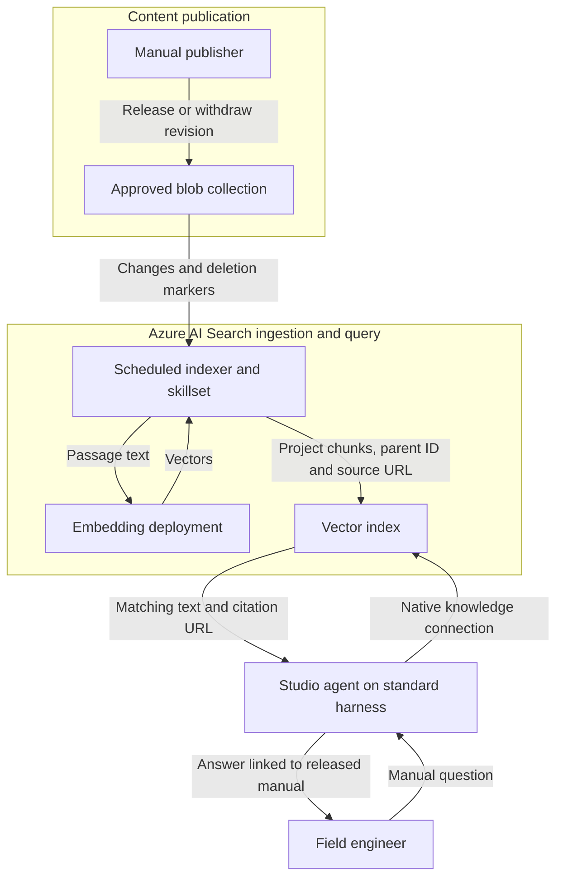
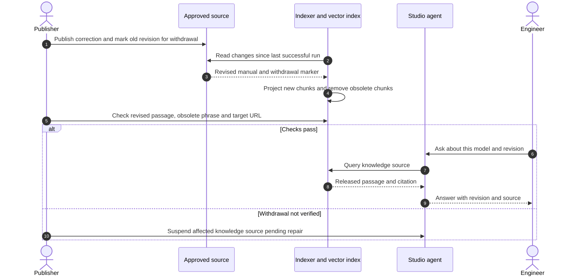

# Keep a native Azure AI Search knowledge source current

**Class:** Synthesized technical pattern. **Intent:** Give field engineers cited answers from a collection of published equipment manuals. All readers can see every manual in this collection. The hard part is not vector similarity: it is proving that a corrected or withdrawn procedure no longer appears in answers.

## Architecture

**Review decision:** Use one shared index only when both the corpus and the agent audience have the same read boundary. A link that fails to open does not protect text already quoted in an answer. For mixed entitlements, choose [permission-aware hybrid retrieval](azure-search-hybrid-rag.md) or retrieval that enforces access at the source.

## Technical flow

## Copilot Studio components

**Recommended build:** Standard harness. The Studio team owns the knowledge connection; the search team owns the index and its ingestion schedule. No Studio workflow is needed to run the indexer.

| Component | Use in this pattern | Harness alternative |
| --- | --- | --- |
| [Knowledge source](../COMPONENTS.md#knowledge-sources) | Add Azure AI Search through a formal data connection and select the vector index. Include a retrievable URL that readers can open. | Native Azure AI Search is documented for standard. On another harness select a supported retrieval tool instead. |
| [Evaluation](../COMPONENTS.md#evaluation) | Test citations in the published channel against the release manifest, including a manual that should be absent. | Reuse the same fixtures when changing retrieval paths. |

**Not the right component:** A Studio skill or a memory entry is not an indexing skillset and cannot retract content.

**Copilot Credits drivers (medium):** Track interactive grounded answers. Scheduled ingestion, embedding calls, index storage and Search capacity are separate from Copilot Credits; a full rebuild can incur Azure costs even with no conversations. See [Copilot Credits guidance](../COPILOT-CREDITS.md).

## Design notes

- **Ingestion contract:** Chunk at useful section boundaries. Project each chunk with stable parent identity, revision and canonical citation URL as well as readable text. Configure the query vectorizer to match the indexing embedding model. Test that Studio picks the intended URL: it uses `metadata_storage_path` when present. Do not put short-lived signed URLs or secrets in citation fields.
- **Trust boundary:** Restrict who can publish a manual, write the index, query the index and use the agent; those are four different grants. Use an approved Entra data connection for Studio and keep ingestion privileges away from the answering agent. This design does not rely on per-document ACL propagation.
- **Failure handling and acceptance:** Configure deletion detection **before the first indexer run**, retain deletion markers long enough for an interrupted indexer to see them, and verify that *all* child chunks disappear. A successful job alone is insufficient. Exercise an update, a withdrawal during a missed run, and a rebuild after an embedding-model change. Where withdrawals cannot tolerate index lag, suspend the source or validate against a live publication register before returning text.

**Sources:** [Native Azure AI Search knowledge in Copilot Studio](https://learn.microsoft.com/en-us/microsoft-copilot-studio/knowledge-azure-ai-search) · [Integrated vectorization](https://learn.microsoft.com/en-us/azure/search/vector-search-integrated-vectorization) · [Index projections](https://learn.microsoft.com/en-us/azure/search/search-how-to-define-index-projections) · [Change and deletion detection](https://learn.microsoft.com/en-us/azure/search/search-how-to-index-azure-blob-changed-deleted).
