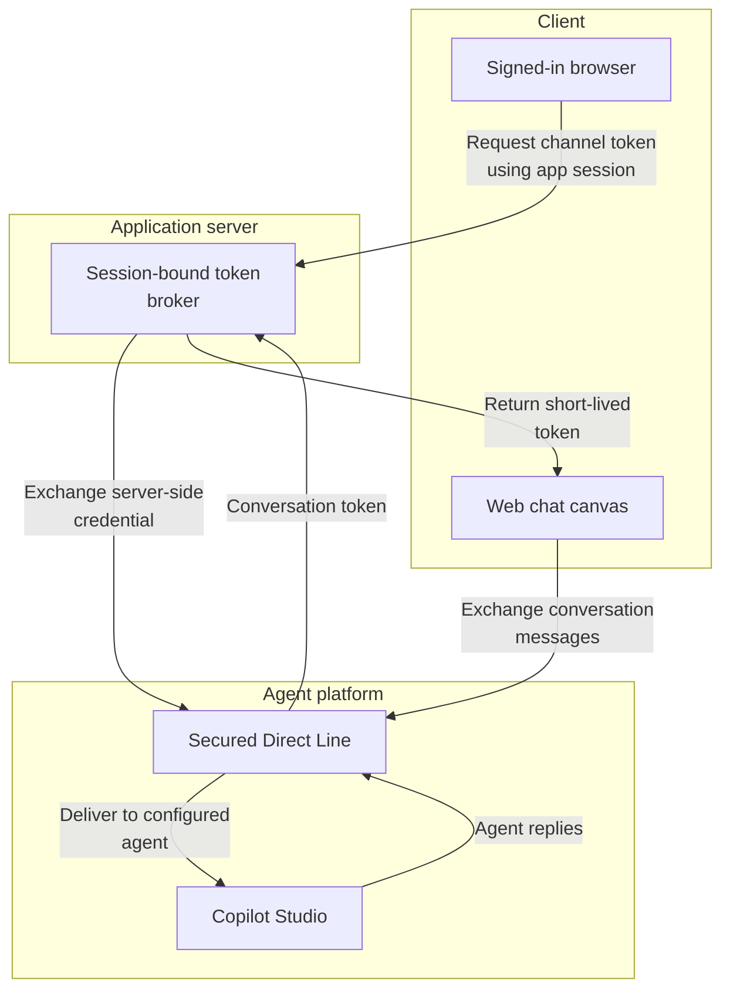
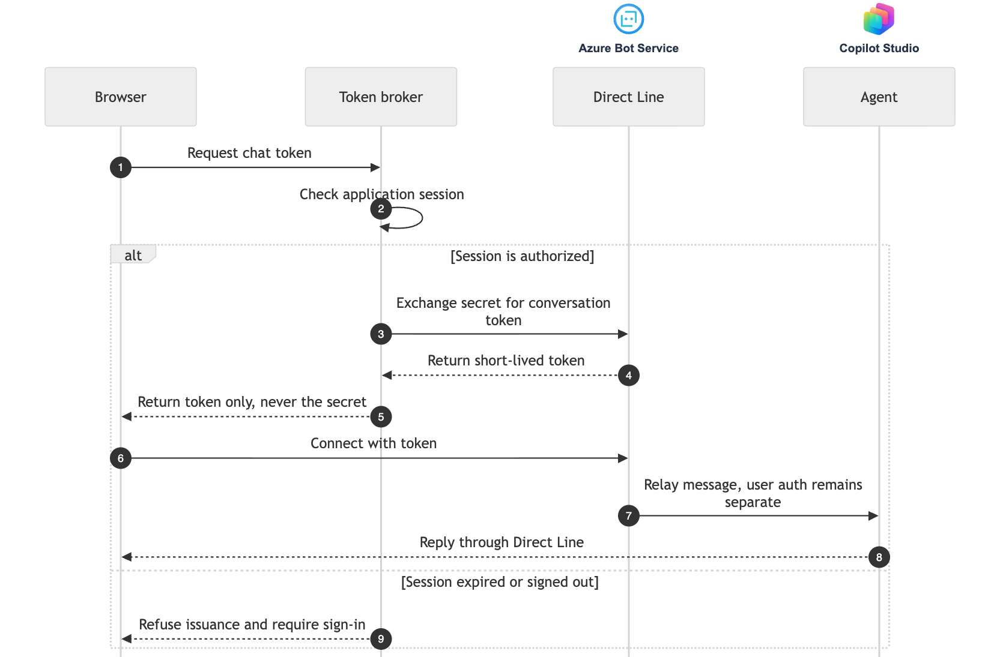
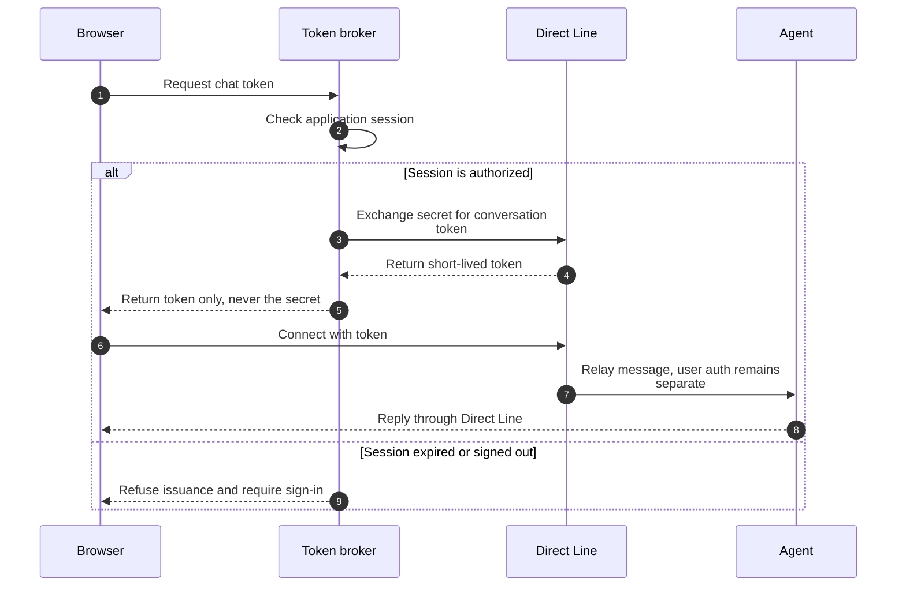

# Embed a web client without exposing channel credentials

**Class:** Synthesized technical pattern. **Intent:** Put a standard-harness agent in an existing authenticated web application without treating possession of a channel credential as customer identity.

## Architecture

**Review decision:** The short-lived token permits channel use; it does not authenticate a customer to a business API. Keep the long-lived Direct Line secret on the server.

## Technical flow

Text and editable Mermaid sequence

## Copilot Studio components

**Recommended build ([harness](../COMPONENTS.md#the-harness-is-the-first-decision)):** Standard harness, secured Direct Line web channel. Validate the custom web channel and authentication options before you choose another harness.

| Component | Use in this pattern | Harness alternative |
| --- | --- | --- |
| [Channel](../COMPONENTS.md#channels): Secured Direct Line | A server-side broker exchanges the secret for a short-lived token. | Validate per harness. |
| [Authentication](../COMPONENTS.md#authentication-and-tool-credentials): Agent sign-in and tool connections | Configure them separately. | All harnesses. |
| [Connector tool](../COMPONENTS.md#connector-tools): User-authenticated tools | Carry the customer's identity to business APIs. | All harnesses. |

**Not the right component:** The Direct Line secret in the browser.

**Copilot Credits drivers (low):** The channel pattern adds no consumption. Web traffic is billed per event unless the user is a licensed employee acting with their own identity. See [Copilot Credits guidance](../COPILOT-CREDITS.md).

## Design notes

**Flow:** The application signs in the user. For a secured Direct Line channel, a server-side component authorizes the session and obtains a short-lived channel token. The browser uses that token to exchange messages through the chat canvas. Configure agent sign-in and downstream tool connections separately; a custom canvas may also need to handle connection-card popups and continuation.

**Choose it when** the application needs a tailored interface or context that a native client cannot supply. A supported built-in channel avoids much of the reconnect, accessibility and consent work.

**Trust boundary:** Never ship the Direct Line secret in browser code. Do not equate a channel token, claimed user ID or possession of a conversation ID with permission to read account records. Bind the conversation to the application session on the server.

**Failure handling:** On expiry, refresh or reestablish the authorized conversation. On logout, stop access rather than resuming another user's chat. Test secret rotation, token expiry and back-to-back users on a shared browser.

**Sources:** [Configure web and Direct Line channel security](https://learn.microsoft.com/en-us/microsoft-copilot-studio/configure-web-security) · [Channel and client design](https://learn.microsoft.com/en-us/microsoft-copilot-studio/guidance/channels).
