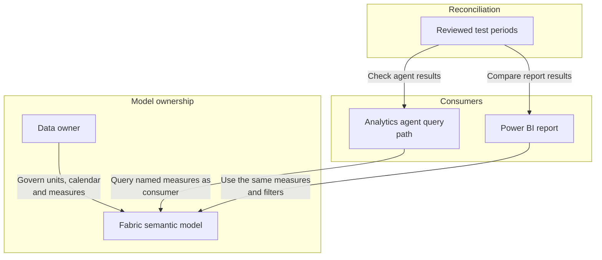
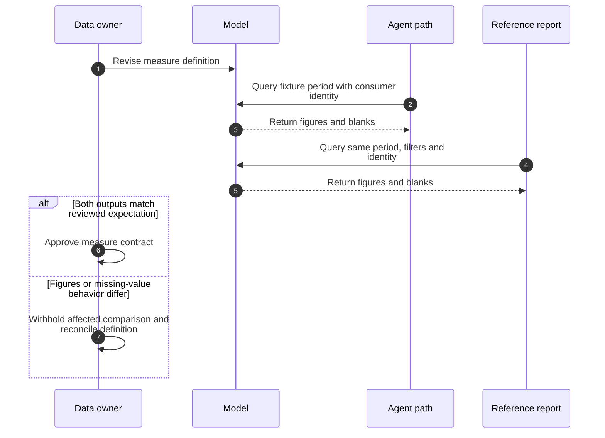

# Share a governed metric contract between agents and reports

**Class:** Synthesized technical pattern. **Intent:** Make “actual,” “target” and “last month” mean the same thing to a chat agent and an analyst's report, regardless of which Fabric integration is used.

## Architecture

**Review decision:** Approve the business definition of a measure, not just its name. The agent and reference report must reconcile for the same identity, filters and refresh state.

## Technical flow

## Design notes

**Flow:** Data owners publish a semantic model with facts, dimensions, a marked date table and approved measures. Document exact names, business calendar, units and missing-value behavior. Point both the reference report and the query-generating component at that model. When scenario codes change, update model logic rather than teaching every agent a new calculation.

**Choose it when** several analytics consumers repeat the same calculations. A model cannot settle conflicting business definitions; nominate a measure owner first. This pattern prepares the data, whereas the [four Fabric choices](../CATALOG.md#fabric-integration-options) decide who queries it.

**Trust boundary:** Model access and RLS determine visible facts. Do not embed restricted results in a generally shared skill or examples. Compare figures using the same consumer identity, filters and refresh state.

**Failure handling:** Keep fixture periods for normal, missing and zero-denominator cases. When a measure changes, validate the report and agent together; withhold affected comparisons until the owner reconciles them.

**Sources:** [Prepare a semantic model for AI agents](https://learn.microsoft.com/en-us/power-platform/architecture/key-concepts/copilot-studio-fabric/semantic-model-ai-agents) · [Evaluate analytical agents](https://learn.microsoft.com/en-us/power-platform/architecture/key-concepts/copilot-studio-fabric/evaluate-analytical-agents).
