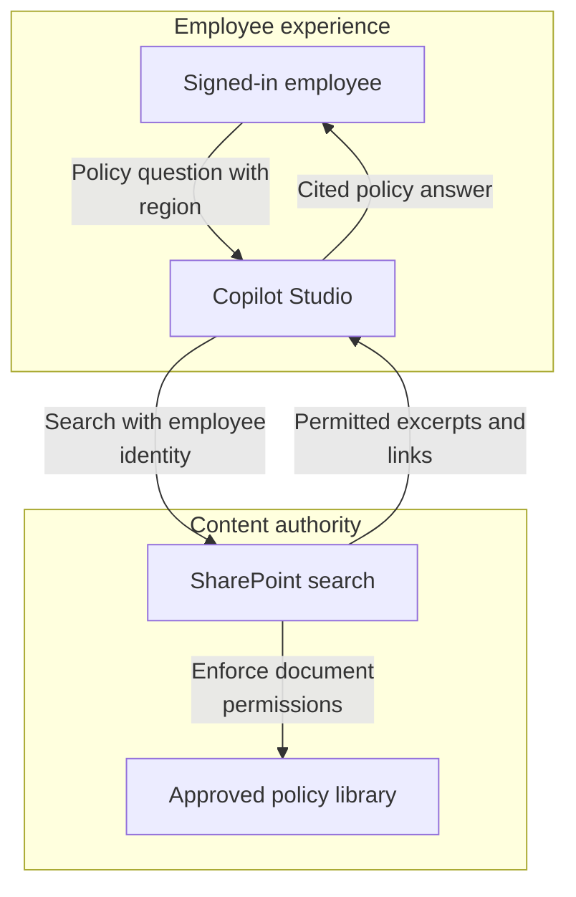
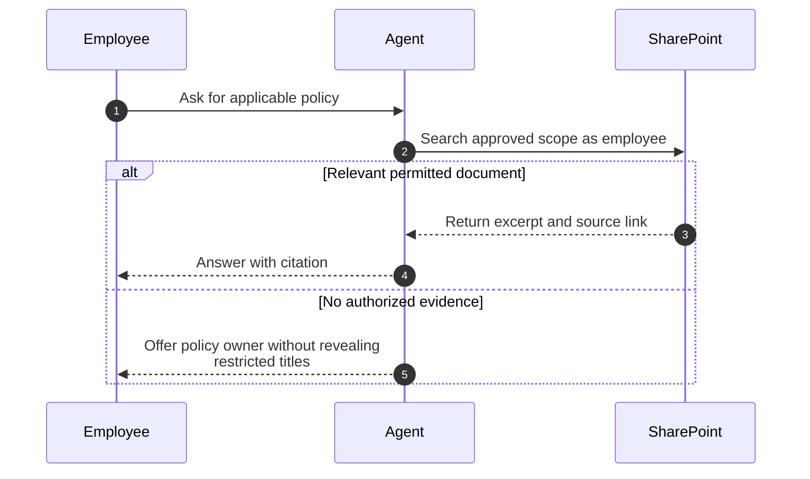

# Permission-trimmed answers from SharePoint

**Class:** Synthesized technical pattern. **Intent:** Answer internal policy questions using the same documents the employee is allowed to open.

## Architecture

**Review decision:** Approve the SharePoint site and the identity used to search it together. A permitted citation for one employee is a disclosure if repeated to another employee who lacks access.

## Technical flow

## Design notes

**Flow:** An authenticated user asks a question → Copilot Studio retrieves from configured SharePoint sites under the user's access → the agent summarizes the retrieved policy and links to it. Scope sources to published, owned content. Ask which country or employee group applies when several policies are plausible.

**Choose it when** document authors already maintain policy and permissions in SharePoint. This avoids copying the library into a second knowledge store. For live balances or decisions that require exact records, call an authorized tool instead. An uploaded copy of a document does not necessarily preserve its original permissions.

**Trust boundary:** Verify the channel supports the required end-user sign-in. Test with actual reader and non-reader accounts. Do not mix restricted SharePoint material with broadly accessible file uploads or a maker connection.

**Failure handling:** With no permitted evidence, say there is no verified answer and offer the policy owner. Do not reveal a restricted title or guess from model knowledge. Test a revoked permission and a superseded policy alongside a known good citation.

**Sources:** [SharePoint as a knowledge source](https://learn.microsoft.com/en-us/microsoft-copilot-studio/knowledge-add-sharepoint) · [Microsoft's retrieval-augmented generation guidance](https://learn.microsoft.com/en-us/microsoft-copilot-studio/guidance/retrieval-augmented-generation).
