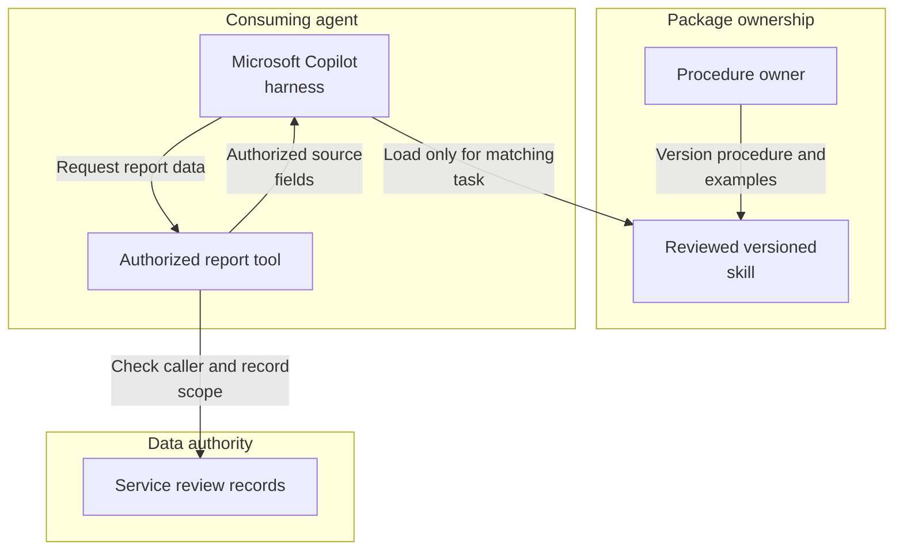
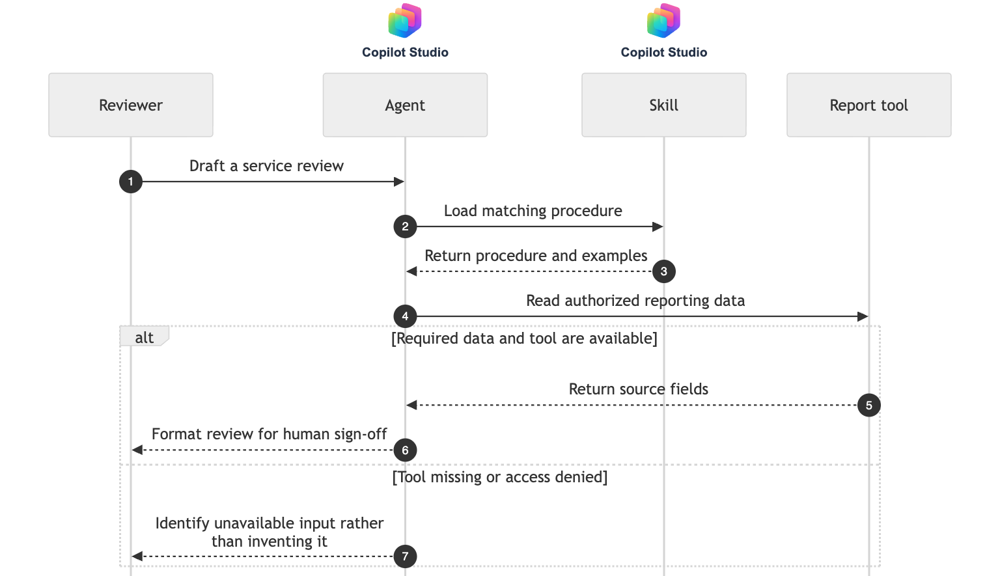
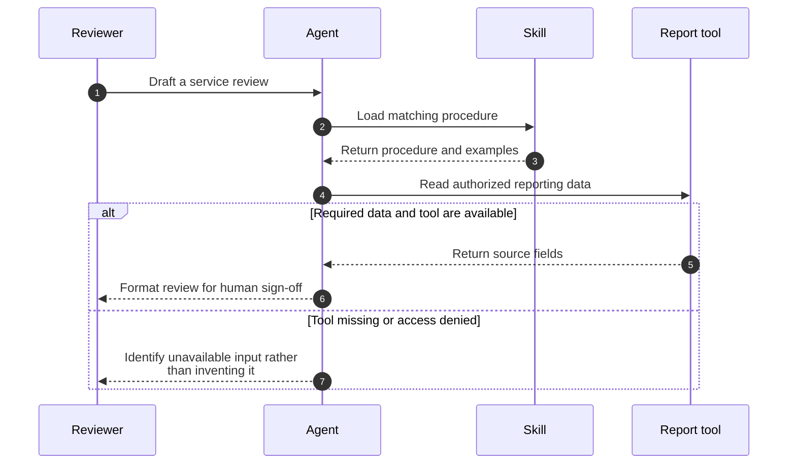

# Package reusable procedures as skills

**Class:** Synthesized technical pattern. **Intent:** Share a bounded procedure, such as formatting a service review, without duplicating long instructions or operating a separate agent.

## Architecture

**Review decision:** Approve a skill as reusable procedure, not as a credential bundle. Its instructions cannot grant the consuming agent access to the data needed to execute it.

## Technical flow

Text and editable Mermaid sequence

## Copilot Studio components

**Recommended build ([harness](../COMPONENTS.md#the-harness-is-the-first-decision)):** Microsoft Copilot harness for the versioned `SKILL.md` package shown. On Customer Conversation, [author a Generative or Topic skill](https://learn.microsoft.com/en-us/microsoft-copilot-studio/agents-experience/skills-create-customer-conversation) rather than assuming the same upload path. On standard, use a topic or prompt tool for this procedure.

| Component | Use in this pattern | Harness alternative |
| --- | --- | --- |
| [Skill](../COMPONENTS.md#skills): Versioned skill folder | Contains `SKILL.md` with optional scripts, references and assets. | Std: topic or prompt. |
| [Instructions](../COMPONENTS.md#instructions): Global behavior only | Stays short because detail lives in the skill. | All harnesses. |
| [Connector tool](../COMPONENTS.md#connector-tools): Authorized report tool | The consuming agent's connection controls data access. | All harnesses. |
| [Evaluation](../COMPONENTS.md#evaluation): Representative review test | Run after each skill version. | All harnesses. |
| [Memory](../COMPONENTS.md#memory): Per-user memory | Holds a user's preferences, not the shared procedure. Put shared rules in the skill. *(Optional.)* | Std: none. |

**Not the right component:** Credentials or permission grants in a skill.

**Copilot Credits drivers (medium):** Progressive loading avoids sending the procedure on unrelated requests. When the skill is selected, its guidance and loaded references add context; measure the effect with representative requests. See [Copilot Credits guidance](../COPILOT-CREDITS.md).

## Design notes

**Flow:** On the Microsoft Copilot harness, keep global behavior in the agent instructions. Package task-specific guidance and vetted resources as a named skill with a precise description. When the request matches, the agent loads the procedure and uses its available tools. Version the skill and check its result against a representative service review.

**Choose it when** several agents perform the same procedure with their own authorized data. A skill describes *how*; use a tool for an external action, a knowledge source for changing policy facts, and a workflow for a mandatory execution order. These instruction-based skills are not the Azure Bot Service skills used by some handoff bridges.

**Trust boundary:** Review packages and any scripts as supply-chain inputs. Do not package credentials, production records or implied permission grants. The consuming agent still needs its own authorized tool connections.

**Failure handling:** Detect missing tools and incompatible versions before rollout. Test an unrelated request that must not load this skill, as well as a matching request with no access to the report. Keep a known-good package to restore through the normal release process.

**Source:** [Skills overview for agents on the Microsoft Copilot harness](https://learn.microsoft.com/en-us/microsoft-copilot-studio/agents-experience/skills-overview).
