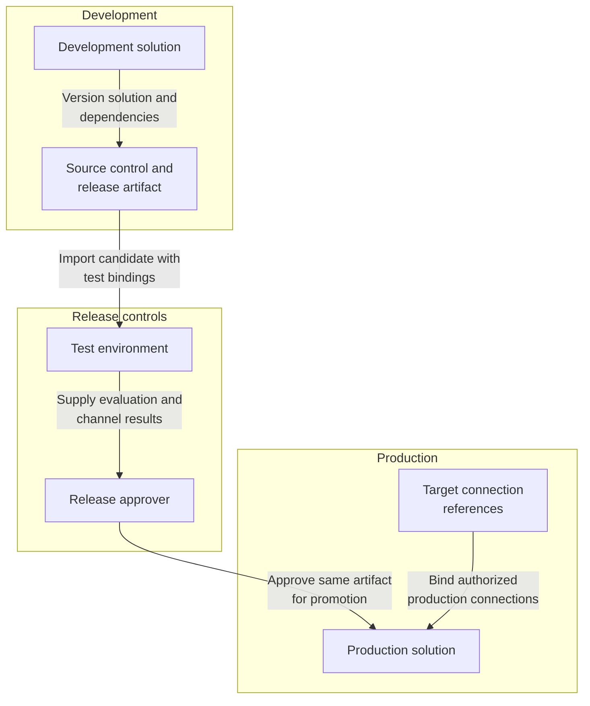
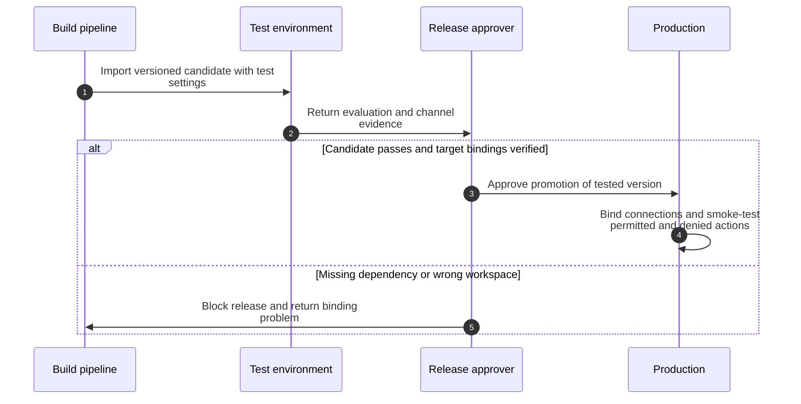

# Promote one tested solution with environment-specific bindings

**Class:** Synthesized technical pattern. **Intent:** Make an agent release repeatable without copying production secrets into a solution or reauthoring behavior in production.

## Architecture

**Review decision:** Approve the artifact and its destination bindings. Promoting identical agent content does not prove that the production connection points to the correct data.

## Technical flow

## Design notes

**Flow:** Build the agent and supported dependencies in a development solution, track the definition in source control and produce a versioned release. Import the candidate into test with its own environment variables, connection references and test identities. Run evaluations and channel smoke tests. Promote the same approved artifact to production, bind its settings and verify the published channel.

**Choose it when** releases need independent validation or several makers work on a shared agent. Pipelines improve repeatability but do not package every external dependency: inventory knowledge sites, model configuration, external agents, consent, connections and channel registrations explicitly.

**Trust boundary:** Separate maker, release approver and deployment identities. A connection reference identifies a binding; it is not permission to transport credentials. Keep secrets in their authorized target environment.

**Failure handling:** Block promotion if a connection points to the wrong workspace or a dependency is missing. Prepare a forward fix or supported recovery to known-good behavior and rehearse it; rolling back agent content does not undo external writes. Recheck one permitted and one denied operation after release.

**Source:** [Copilot Studio application lifecycle management strategy](https://learn.microsoft.com/en-us/microsoft-copilot-studio/guidance/alm).
