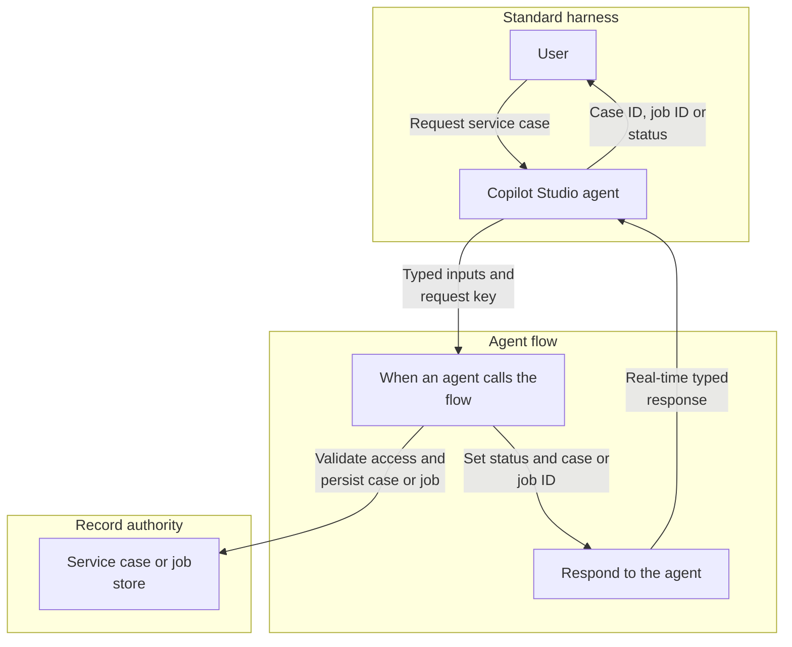
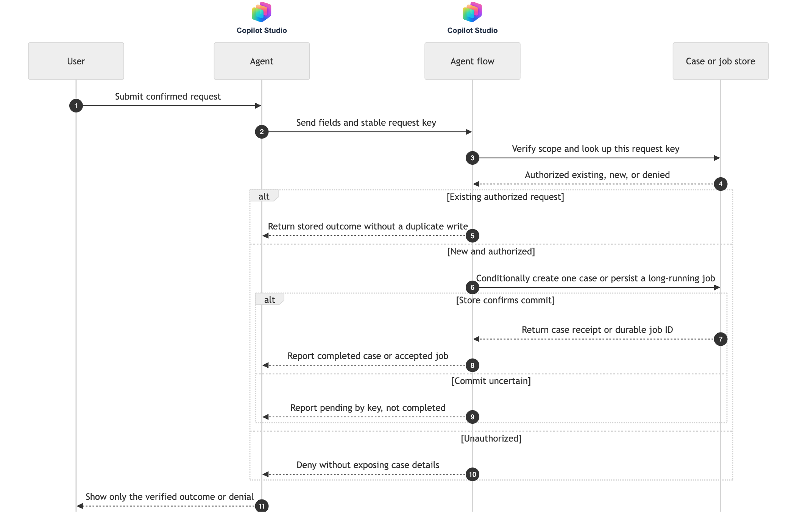
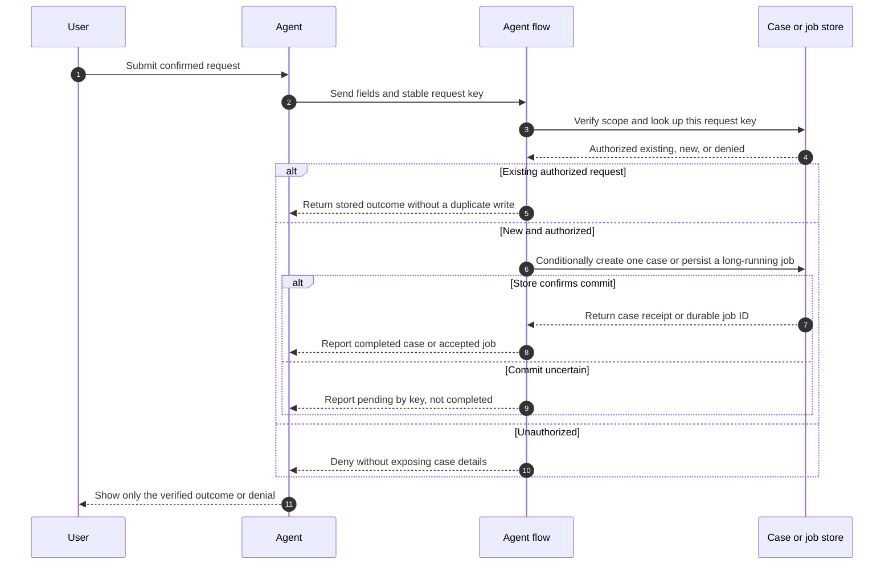

# Return a typed result from an agent flow

**Class:** Synthesized technical pattern. **Intent:** Give a conversation one predictable operation assembled from several connector calls, such as validating a request and creating a service case.

## Architecture

**Review decision:** Choose whether the response means completed or accepted. Only a system receipt supports completed; long work needs a durable job reference and status lookup.

## Technical flow

Text and editable Mermaid sequence

## Copilot Studio components

**Recommended build ([harness](../COMPONENTS.md#the-harness-is-the-first-decision)):** Standard harness agent flow in a solution in the agent's environment. For user-scoped operations, check each connector's run-only connection settings; calling the flow from an authenticated topic does not itself delegate the user's identity. On the Microsoft Copilot harness, [add a workflow as an agent tool](https://learn.microsoft.com/en-us/microsoft-copilot-studio/workflows-experience/flow-agent).

| Component | Use in this pattern | Harness alternative |
| --- | --- | --- |
| [Agent flow](../COMPONENTS.md#agent-flows): When an agent calls the flow | Typed inputs. | Copilot: workflow. |
| [Agent flow](../COMPONENTS.md#agent-flows): Respond to the agent | Return `status`, `reference` and `message` within 100 seconds. The reference identifies the committed case, accepted job or pending request according to `status`. | Copilot: workflow. |
| [Connector tool](../COMPONENTS.md#connector-tools): System-of-record actions | Validate, then create the case. | All harnesses. |
| [Variables](../COMPONENTS.md#variables-and-conversation-state): Typed outputs | Keep the conversation's view of the operation explicit. | Copilot: workflow variables. |

**Not the right component:** Long-running work behind a synchronous response.

**Copilot Credits drivers (low):** Agent flow actions bill at 13 per 100 (0.13 each). They are included when a licensed Microsoft 365 Copilot user's interactive session calls the flow, and charged for autonomous runs. See [Copilot Credits guidance](../COPILOT-CREDITS.md).

## Design notes

**Flow:** On the standard harness, the agent invokes a flow with **When an agent calls the flow**. The flow validates typed inputs and checks the system of record. For a new authorized request it creates the case once; for a duplicate it returns the existing outcome. Use **Respond to the agent** with the same typed result on every branch and **Asynchronous response** off.

**Choose it when** execution order must be fixed and a result can be returned within the turn. For longer processing, persist a job and respond with an *accepted* receipt, not a completion claim. Run later steps after the response or in a separate worker; provide status lookup.

**Trust boundary:** Inspect the effective connection for each flow action. A user's authenticated conversation does not automatically make every connector call delegated. Revalidate record ownership in the write path.

**Failure handling:** Use a stable request key. If the flow times out after a write, look up the case instead of resubmitting. Test missing inputs, duplicate invocations and a downstream step that takes longer than the response budget.

**Source:** [Create an agent flow as a tool: trigger, response, credentials and limits](https://learn.microsoft.com/en-us/microsoft-copilot-studio/advanced-flow-create).
