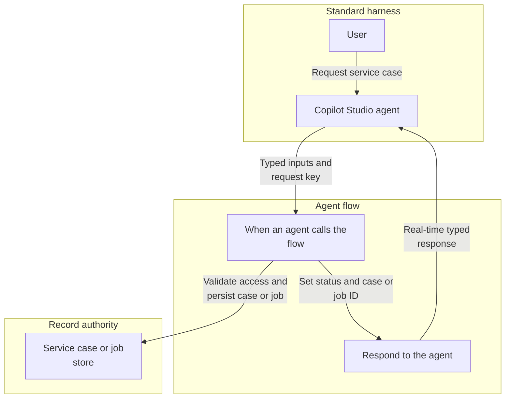
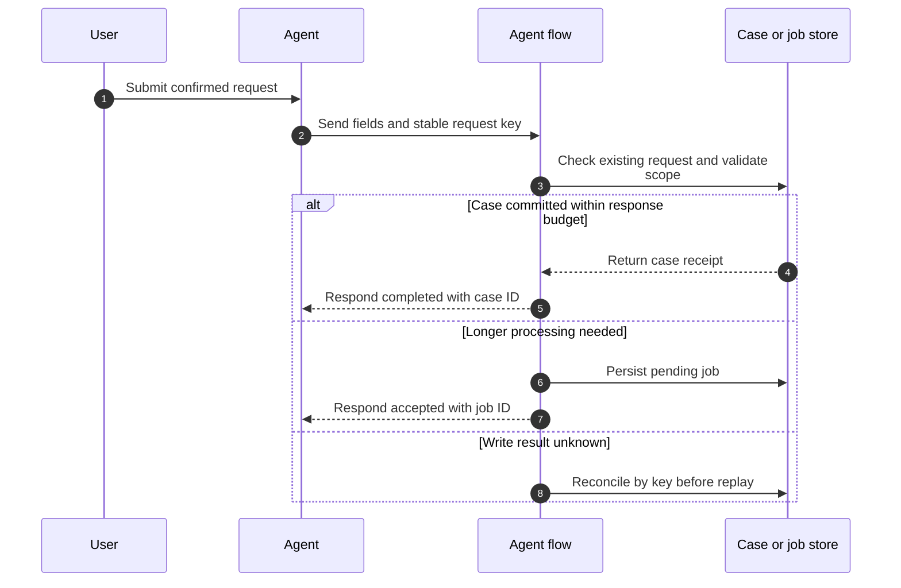

# Return a typed result from an agent flow

**Class:** Synthesized technical pattern. **Intent:** Give a conversation one predictable operation assembled from several connector calls, such as validating a request and creating a service case.

## Architecture

**Review decision:** Choose whether the response means completed or accepted. Only a system receipt supports completed; long work needs a durable job reference and status lookup.

## Technical flow

## Design notes

**Flow:** On the standard harness, the agent invokes a flow with **When an agent calls the flow**. The flow validates typed inputs, checks the system of record, performs the permitted operation, and uses **Respond to the agent** with a small result such as `status`, `caseId` and `message`. Configure a real-time response; the documented action limit is 100 seconds.

**Choose it when** execution order must be fixed and a result can be returned within the turn. For longer processing, persist a job and respond with an *accepted* receipt, not a completion claim. Run later steps after the response or in a separate worker; provide status lookup.

**Trust boundary:** Inspect the effective connection for each flow action. A user's authenticated conversation does not automatically make every connector call delegated. Revalidate record ownership in the write path.

**Failure handling:** Use a stable request key. If the flow times out after a write, look up the case instead of resubmitting. Test missing inputs, duplicate invocations and a downstream step that takes longer than the response budget.

**Source:** [Create an agent flow as a tool: trigger, response, credentials and limits](https://learn.microsoft.com/en-us/microsoft-copilot-studio/advanced-flow-create).
