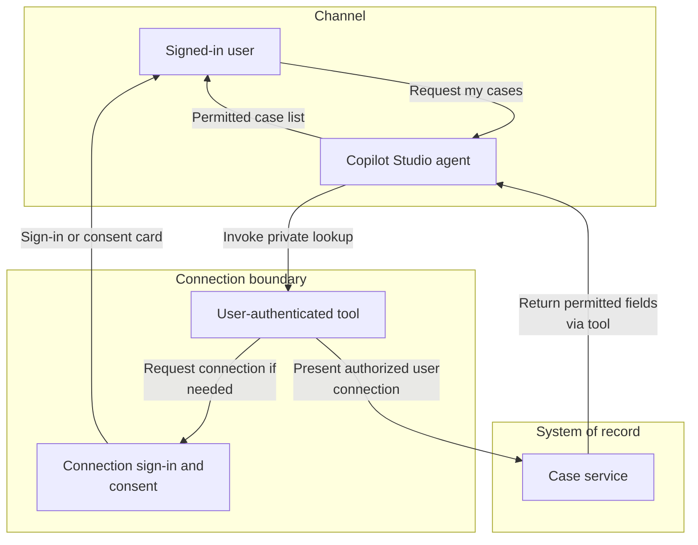
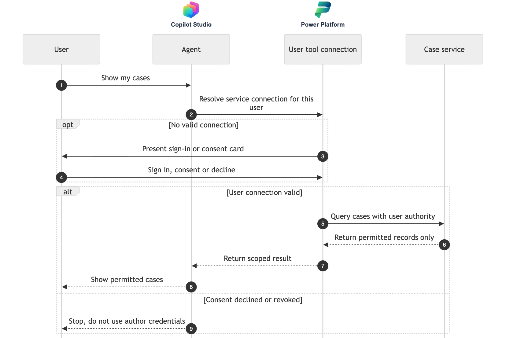
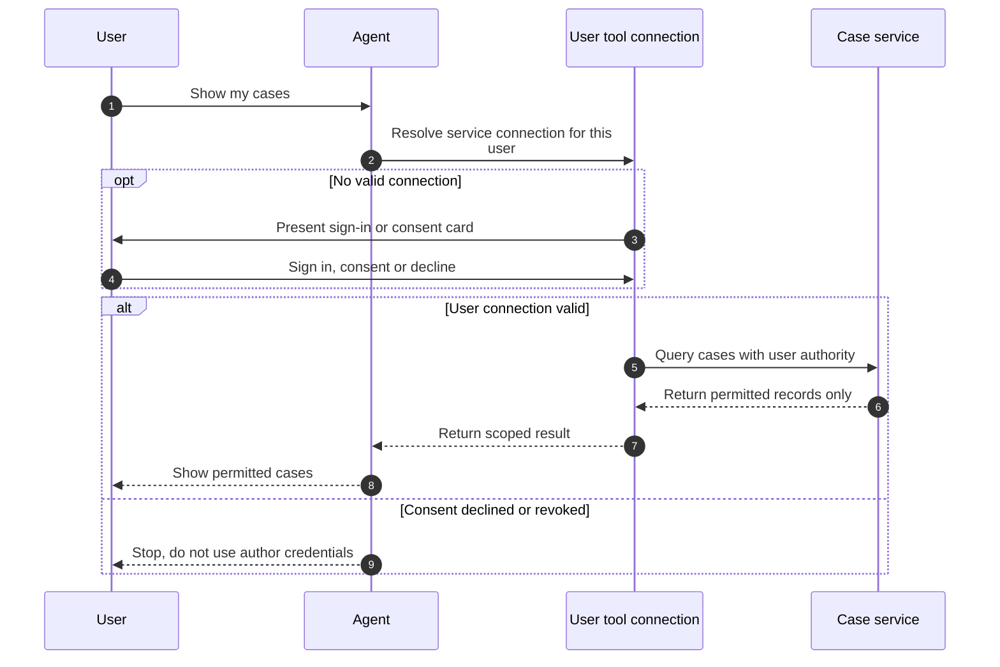

# Carry the user's authority to a downstream tool

**Class:** Synthesized technical pattern. **Intent:** Ensure “show my cases” runs with the caller's permissions, not those of the person who built the agent.

## Architecture

**Review decision:** Agent sign-in and downstream authorization are different checks. Approve a private tool only if the service receives the intended identity and enforces record access.

## Technical flow

Text and editable Mermaid sequence

## Copilot Studio components

**Recommended build ([harness](../COMPONENTS.md#the-harness-is-the-first-decision)):** Use delegated connections in a channel that supports user sign-in. On the Microsoft Copilot harness, a workflow invoked with **When an agent calls the flow** uses the invoking user's connections for connector actions. Do not extrapolate this to a scheduled run or an [agent with its own account](../COMPONENTS.md#agent-account-frontier).

| Component | Use in this pattern | Harness alternative |
| --- | --- | --- |
| [Authentication](../COMPONENTS.md#authentication-and-tool-credentials): Agent sign-in | Authenticates the user to the agent. | All harnesses. |
| [Connector tool](../COMPONENTS.md#connector-tools): User authentication | Prompt for the caller's connection where the channel supports it; otherwise withhold the private operation. | CC speech: voice verification is not delegated sign-in. |
| [Agent flow](../COMPONENTS.md#agent-flows): Per-step connections | Inspect which connection each step uses. | Copilot: workflow. |

**Not the right component:** Maker credentials for per-user records.

**Copilot Credits drivers (low):** Delegated identity is necessary, but not sufficient, for standard-harness employee inclusion. Signing in does not make a Copilot-harness interaction free or convert an autonomous run into an interactive one. See [Copilot Credits guidance](../COPILOT-CREDITS.md).

## Design notes

**Flow:** Authenticate the user to the agent in a supported channel. Configure the private tool for **User authentication**. On invocation Copilot Studio finds the user's service connection or presents a connection card. The service authorizes the operation and record; the agent returns only permitted fields. Inspect the actual connection for each flow step as well.

**Choose it when** the underlying data or action is personal, role-scoped or auditable per user. Agent-author credentials can fit a tightly scoped, low-risk shared lookup (for example, published office hours). They are not a substitute for missing delegation on a private record system.

**Trust boundary:** Channel sign-in, permission to use the agent and permission to call the downstream API are separate. A user ID supplied in a prompt proves none of them. Check the product's channel support matrix, including custom-client consent handling.

**Failure handling:** Reconnect on expired consent; on denial, end the operation without an author-credential fallback. Test two users with different case access, revoked consent and a reused browser session.

**Sources:** [Configure end-user authentication for tools and supported channels](https://learn.microsoft.com/en-us/microsoft-copilot-studio/configure-enduser-authentication) · [Microsoft public SSO examples](https://github.com/microsoft/CopilotStudioSamples/tree/main/sso/entra-id).
