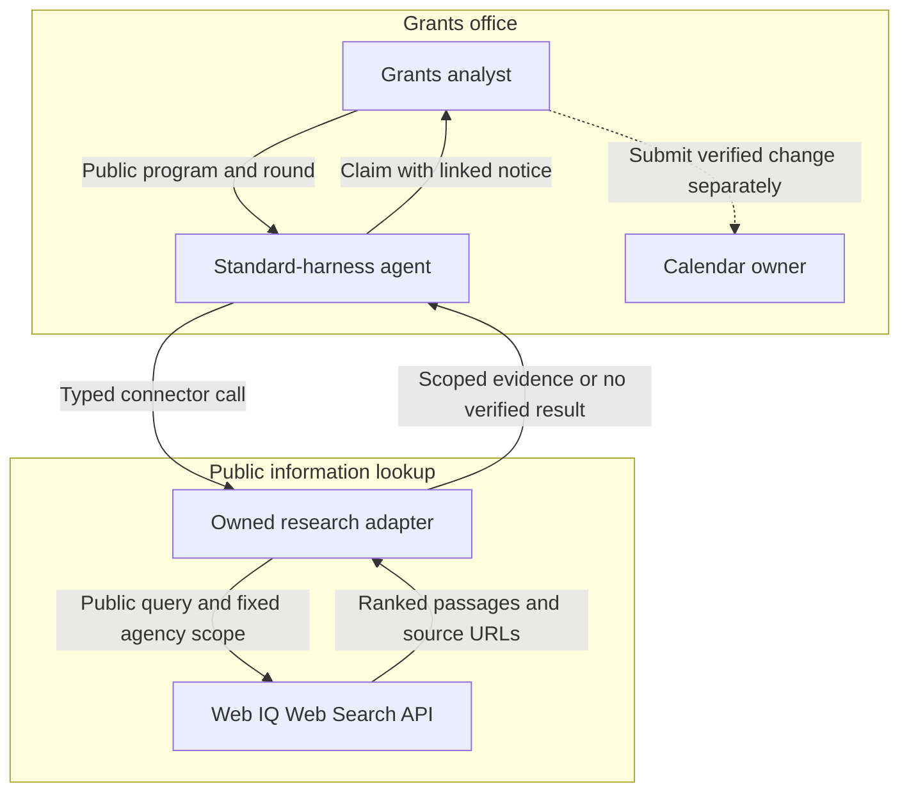
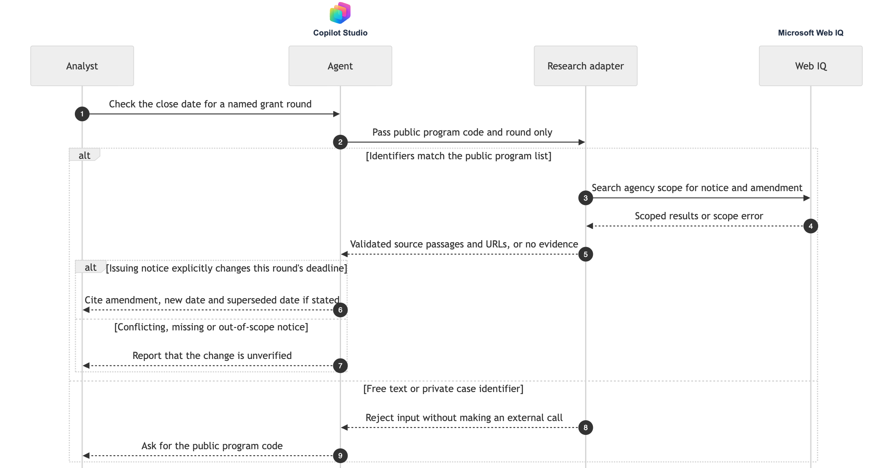
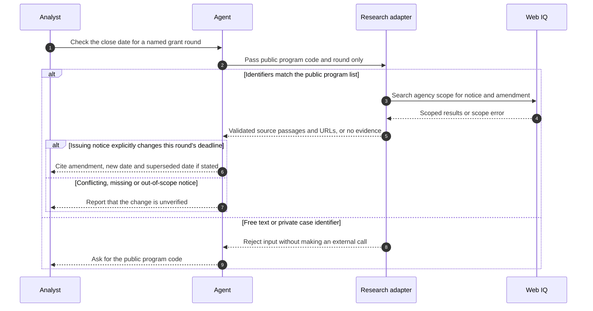

# Verify a grant deadline against public notices with Microsoft Web IQ

**Class:** Synthesized technical pattern. **Intent:** Give a grants analyst a cited answer to “Did the agency extend this deadline?” without sending an applicant's file to search or updating the grants calendar on the strength of a search result.

## Architecture

**Review decision:** Which issuing authorities can substantiate a deadline, and what may leave the office in a query? A recent crawl of an old notice is not an extension.

## Technical flow

Text and editable Mermaid sequence

## Copilot Studio components

**Recommended build ([harness](../COMPONENTS.md#the-harness-is-the-first-decision)):** Standard harness, an authored topic and a custom connector to a team-owned adapter. **Microsoft Web IQ** (sometimes written “WebIQ”) is a documented API suite. Its Web Search API is generally available; this connector is our integration design, not a native Studio tool named Web IQ.

| Component | Use in this pattern | Alternative |
| --- | --- | --- |
| [Topic](../COMPONENTS.md#topics-and-system-topics) | Collect program and round; keep application narratives out of the tool inputs. | Microsoft Copilot harness: use the same bounded connector for a longer research brief. |
| [Connector tool](../COMPONENTS.md#connector-tools) | The adapter constructs the public query, authenticates to Web IQ and validates each result. | Web IQ also exposes an account-scoped `web` tool at `https://api.microsoft.ai/v3/mcp`. Validate client/auth support; enforce any mandatory scope in code, not in agent instructions. |
| [Human gate](../COMPONENTS.md#human-in-the-loop-gates) | Calendar owner opens the cited notice and authorizes changes in the grants system. | For information only, end at the cited brief; no write tool is needed. |

**Copilot Credits drivers (medium):** Standard-harness topic/tool actions and a generated answer where metered. Budget Web IQ API calls on the paid Azure subscription and adapter operation separately from Copilot Credits. Cap searches per round; don't repeat a search just to reformat the answer. See [Copilot Credits guidance](../COPILOT-CREDITS.md).

## Design notes

**Choose it when** you need to reconcile a notice and later amendments, not simply answer a visitor's FAQ from [public website knowledge](public-knowledge.md). The adapter calls `POST https://api.microsoft.ai/v3/search/web` under an authorized Web IQ AppID. Fix `scopeName` to the approved agency collection, set `failOnMissingScope: true`, request a few short `passage` results and require `scopeApplied: true`. Check result URLs against current issuer rules as well: the flag does not certify the latest scope definition. Keep credentials server-side.

**Trust boundary:** Search retrieves passages; it doesn't certify the issuer, determine eligibility or grant approval. Check program, round and effective date in the issuing notice. The `freshness` filter concerns *discovery*, not publication. Treat page instructions as untrusted. Show a visible source link next to each supported claim. Check connector traces and Studio transcripts against Web IQ display and retention terms before rollout: do not log raw passages or build a search archive; an internal summary with its source links is different from a copy of the results.

**Acceptance tests:** An explicit extension for the requested round should yield its new date and linked amendment. A newly discovered notice for last year's round must not. Remove the named scope or simulate throttling: no unscoped retry, no inferred deadline. Pass an applicant number: zero outbound calls. In every case, the grants calendar is unchanged.

**Sources:** [Web IQ Web Search contract](https://learn.microsoft.com/en-us/web-iq/reference/web-search) · [Web IQ MCP tools and scope enforcement](https://learn.microsoft.com/en-us/web-iq/integrations/mcp) · [Web IQ availability and pricing](https://learn.microsoft.com/en-us/web-iq/resources/pricing) · [Attribution and retention FAQ](https://learn.microsoft.com/en-us/web-iq/resources/faq) · [Copilot Studio connector integration choices](https://learn.microsoft.com/en-us/microsoft-copilot-studio/guidance/integrations).
