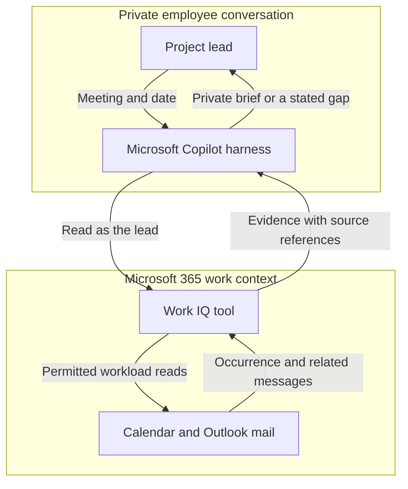
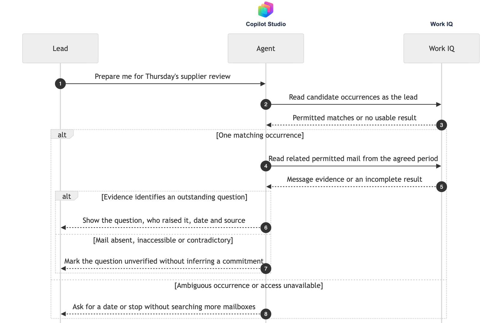
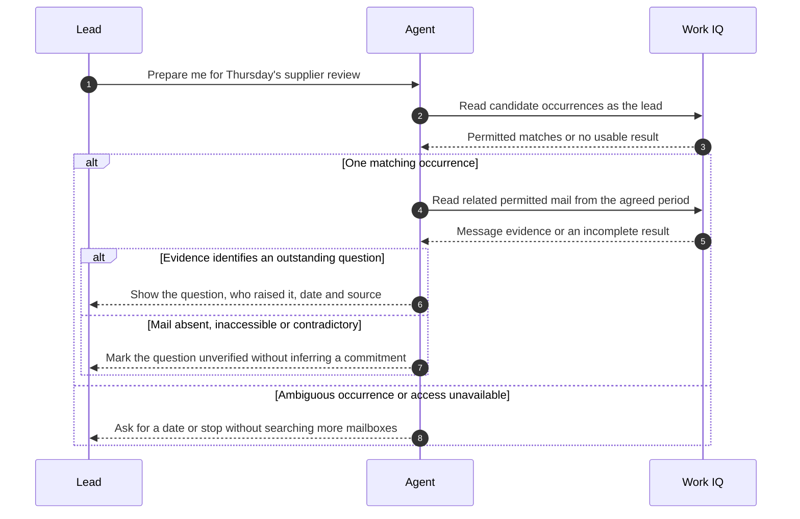

# Prepare a private meeting brief with Work IQ

**Class:** Synthesized technical pattern. **Intent:** Help a project lead prepare for one supplier review by matching a calendar occurrence to recent correspondence. Return open questions and their sources to the lead, not to everyone on the invitation.

## Architecture

**Review decision:** Can the team enforce a read-only path and a private destination? A calendar invitation establishes who is meeting, not who may see the lead's correspondence.

## Technical flow

Text and editable Mermaid sequence

## Copilot Studio components

**Recommended build ([harness](../COMPONENTS.md#the-harness-is-the-first-decision)):** Microsoft Copilot harness with its **Work IQ** tool. The Studio integration is generally available and added to new agents on this harness. Keep only Calendar and Outlook mail selected; Business apps is a separate preview workload and isn't needed.

| Component | Use in this pattern | Alternative |
| --- | --- | --- |
| [Tool](../COMPONENTS.md#mcp-servers): Work IQ | Reads across the two workloads. At the MCP layer, `fetch` reads relative resource paths such as `/me/events/{event-id}` and `/me/messages`. | On standard, use explicitly read-only, user-authenticated calendar and mail connector operations. This is a narrower substitute, **not** the unified Work IQ experience. |
| [Authentication](../COMPONENTS.md#authentication-and-tool-credentials) and [channel](../COMPONENTS.md#channels) | Require end-user sign-in and a one-to-one conversation. Do not send a private result into meeting chat. | If the channel can't establish both, direct the user to Outlook. |
| [Instructions](../COMPONENTS.md#instructions) | Match occurrence, supplier and time window; distinguish correspondence from an agreed decision. | For a single policy library use [SharePoint grounding](sharepoint-grounding.md), not a mailbox search. |

**Copilot Credits drivers (medium):** Work IQ calls, message context, model output and harness runtime are usage-based, including tests. Limit the lookback and number of messages per brief; an employee's Microsoft 365 Copilot license isn't a blanket inclusion for this harness. See [Copilot Credits guidance](../COPILOT-CREDITS.md).

## Design notes

**Choose it when** preparation depends on the relationship between a meeting and correspondence. Check tenant enablement and the user's billing-plan assignment. Workload selection is at service level, not per mailbox, folder or site. If the requirement is a hard resource allowlist, use a narrower adapter. This pattern needs entity reads, not the [preview `retrieve` MCP tool](https://learn.microsoft.com/en-us/microsoft-365/copilot/extensibility/work-iq/mcp/overview). The Work IQ REST API is a conversational interface; it isn't a raw mail feed or a common API for other IQ capabilities.

**Trust boundary:** Studio documents writes as on by default, subject to permissions and policy; the Work IQ MCP policy guide separately describes a tenant-level default block on mutations. Neither a workload checkbox nor “don't send” in instructions proves effective read-only access. Require a verified deny on sends, edits and other mutations, or use the read-only substitute. Treat mail bodies as evidence, never authority to forward a message or approve terms.

**Acceptance tests:** Give a reader two recurring meetings with the same title: no mail lookup until the occurrence is resolved. For a known occurrence, verify each claimed open question against a message the lead can open. Repeat after access revocation with a new request: no cached quote, restricted title or link. A message asking the agent to notify all attendees must produce no send or calendar change.

**Sources:** [Work IQ in Copilot Studio](https://learn.microsoft.com/en-us/microsoft-copilot-studio/agents-experience/add-work-iq) · [Work IQ MCP tools](https://learn.microsoft.com/en-us/microsoft-365/copilot/extensibility/work-iq/mcp/tool-reference) · [MCP policy governance](https://learn.microsoft.com/en-us/microsoft-365/copilot/extensibility/work-iq/mcp/policy-governance-mcp) · [Tenant prerequisites](https://learn.microsoft.com/en-us/microsoft-365/copilot/extensibility/work-iq/enable-work-iq) · [Work IQ REST capabilities and limits](https://learn.microsoft.com/en-us/microsoft-365/copilot/extensibility/work-iq/rest/overview).
