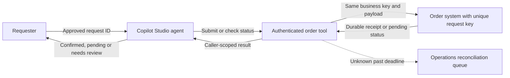
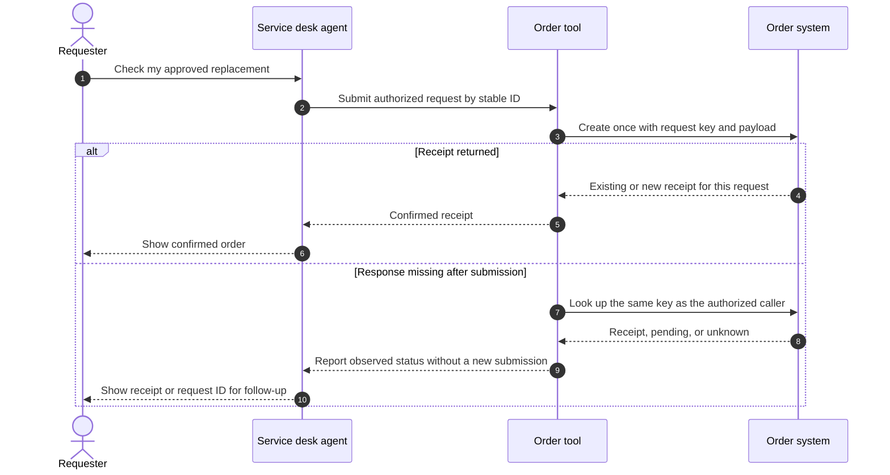

# Reconcile an uncertain write before retrying it

**Class:** Synthesized technical pattern. **Intent:** A service desk agent submitted an approved replacement order, but the reply timed out. Find out whether the order exists without placing it twice. This starts **after** authorization; it is not another approval workflow.

## Architecture

**Review decision:** Which system guarantees one effect per business request and can return its receipt? A flow run ID identifies an attempt; it cannot prove the downstream write happened once.

## Technical flow

Text and editable Mermaid sequence

## Copilot Studio components

**Recommended build:** Standard harness. The connector invokes a business API that atomically binds a caller-scoped key and payload to a single order. A [workflow approval](approval-workflow.md) or an existing order system provides authorization before this sequence.

| Component | Use in this pattern | Harness alternative |
| --- | --- | --- |
| [Connector tool](../COMPONENTS.md#connector-tools) | Expose submit and read-status operations. Bind the status lookup to the same tenant and authorized user as the order. | On another harness, keep the same backend contract; replacing the caller with MCP does not add idempotency. |
| [Human gate](../COMPONENTS.md#human-in-the-loop-gates) | Operations resolves ambiguous aged requests against the source before anyone replays them. | A case queue can outlive the chat session. |

**Copilot Credits drivers (medium):** Count submission and status lookups where metered. Return a tracking reference instead of keeping the agent polling; estimate background reconciliation and the order service separately. See [credit profiles](../COPILOT-CREDITS.md#pattern-credit-profiles).

## Design notes

- **Use when:** Retries could create duplicate refunds, orders or postings. For a service with no unique external key, idempotent operation or authoritative lookup, do not promise exactly-once behavior: hold ambiguous calls for review. A local “sent” flag cannot close the gap between a remote commit and a lost acknowledgment.
- **Trust:** The backend derives or verifies the key from the approved immutable business request and tenant; it does not trust a model-generated UUID on each turn. Reuse of a key with changed amount, recipient or payload is a conflict, not a replay. Recheck authorization on lookups and never treat possession of a request ID as authority.
- **Test:** Drop the response *after* the backend commits. Submit the same approved operation concurrently and again from a new conversation: the caller should see one business receipt. Repeat with a changed payload and a different tenant; neither may get that receipt. If a not-found response can lag the write, wait or escalate; replay only when the downstream idempotency guarantee still applies.

**Sources:** [Azure Architecture Center: Asynchronous Request-Reply, including idempotency keys](https://learn.microsoft.com/en-us/azure/architecture/patterns/asynchronous-request-reply) · [Retry pattern and idempotency](https://learn.microsoft.com/en-us/azure/architecture/patterns/retry) · [Studio tool credentials](https://learn.microsoft.com/en-us/microsoft-copilot-studio/configure-enduser-authentication).
