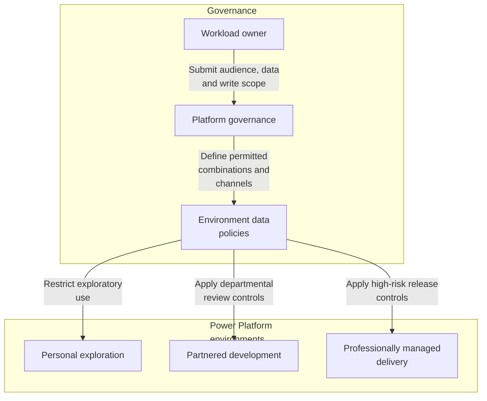
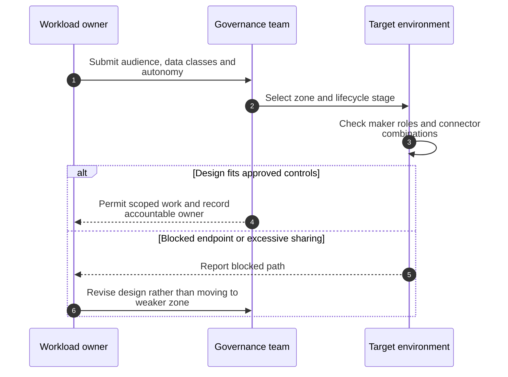

# Match environment controls to agent risk

**Class:** Synthesized technical pattern. **Intent:** Allow experimentation without giving an experimental agent a path to production records or unrestricted publication.

## Architecture

**Review decision:** Decide the workload's risk zone separately from its lifecycle stage. Connector policy limits paths between services; it does not grant record-level permissions.

## Technical flow

## Design notes

**Flow:** Inventory the proposed audience, data sources, autonomy and write permissions. Assign an owner and a risk zone: personal/read-only exploration, partnered departmental development, or professionally managed mission-critical delivery. In Power Platform, apply environment roles and data policies to the relevant zones; review connector combinations, endpoints, authentication and intended channels before sharing.

**Choose it when** many teams build agents and a single policy is either too permissive or too restrictive. A risk zone is not the same as a lifecycle stage: a high-risk workload still needs separate development, test and production environments.

**Trust boundary:** Power Platform connector groups (Business, Non-business, Blocked) govern data paths; they do not grant row permissions or redact content. Keep production credentials and private data out of experimentation, and restrict who can change the policies.

**Failure handling:** When a policy blocks an integration, surface the reason and route the design to its owner; do not move it to a less restricted environment. Test an allowed business connector pair, a blocked external path and a maker who cannot publish to the production audience.

**Sources:** [Implement a zoned governance strategy](https://learn.microsoft.com/en-us/microsoft-copilot-studio/guidance/sec-gov-phase2) · [Configure Copilot Studio data policies](https://learn.microsoft.com/en-us/microsoft-copilot-studio/admin-data-loss-prevention).
